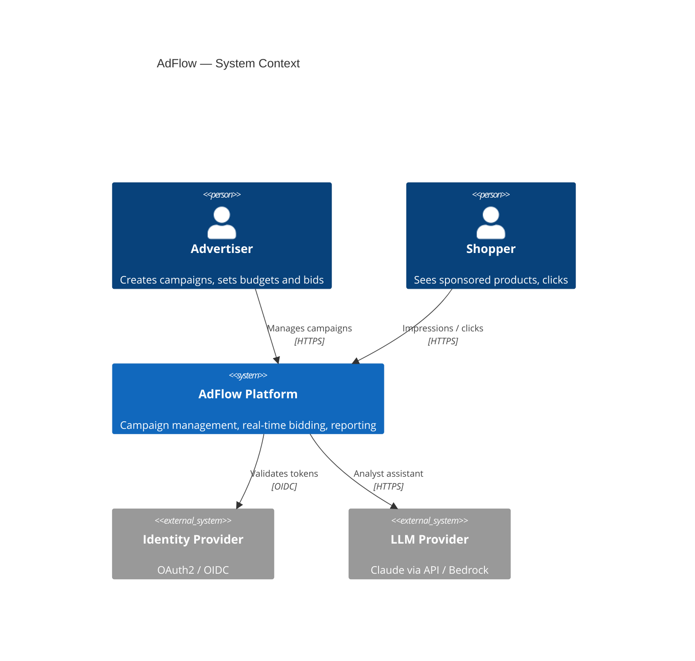
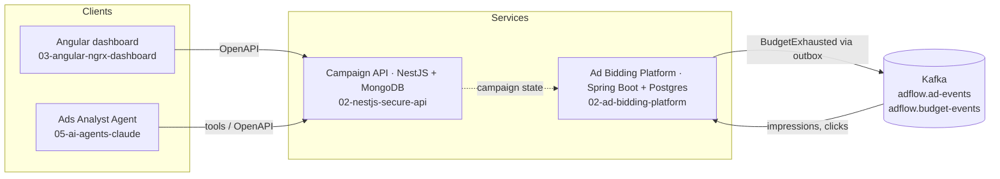

# 01 · Reference Architecture — AdFlow

A reference architecture for **AdFlow**, a fictional sponsored-product advertising platform. It is the "map" of this repository: the other projects implement slices of it.

## Experience this project reflects

Over 23 years I have defined architectures for banking/finance, retail, e-learning and advertising systems, moving teams from monoliths and application servers (JEE, JBoss, WebSphere) to cloud-native microservices on AWS, GCP and Azure. This project shows *how I think*, not just what I code:

- Starting from **quality attributes** (latency, availability, cost, security) instead of technology.
- Recording decisions as **ADRs** with the alternatives I rejected.
- Using **C4 diagrams** so business, developers and operators read the same system at different zoom levels.
- Applying **event-driven design, API-first contracts and DDD** where they pay off, and saying plainly where they do not.

No employer, client or proprietary detail appears here. The domain is invented.

## Context (C4 level 1)

## Containers (C4 level 2)

Contracts live in [`shared/contracts`](../../shared/contracts): OpenAPI for synchronous APIs, AsyncAPI for events.

## Quality attributes

| Attribute | Target (illustrative) | Tactic |
|---|---|---|
| Latency | Bid decision p99 < 50 ms | Read-optimised model, no remote calls on the hot path |
| Availability | 99.95 % for bidding | Stateless instances, autoscaling, multi-zone |
| Correctness | No double-charging | Idempotent consumers, outbox, integer cents |
| Security | Least privilege, zero trust between services | OAuth2/JWT, RBAC, secrets manager |
| Cost | Predictable LLM and cloud spend | Budgets and caps, caching, right-sized compute |
| Evolvability | Teams ship independently | Contract-first APIs, ArchUnit fitness functions |

## Architecture Decision Records

| # | Decision |
|---|---|
| [0001](adr/0001-event-driven-for-ad-events.md) | Event-driven ingestion for impressions and clicks |
| [0002](adr/0002-api-first-contracts.md) | API-first with OpenAPI and AsyncAPI |
| [0003](adr/0003-polyglot-java-and-nestjs.md) | Polyglot: Spring Boot for core, NestJS for edge APIs |
| [0004](adr/0004-idempotency-and-outbox.md) | At-least-once delivery with idempotent consumers and outbox |
| [0005](adr/0005-mongodb-vs-postgres.md) | MongoDB for campaigns, PostgreSQL for money |
| [0006](adr/0006-llm-agent-guardrails.md) | LLM agent: read-only tools, budgets, evals |
| [0007](adr/0007-modular-before-microservices.md) | Start modular; split on evidence |

## Honest scope

This is a reference and teaching architecture. It was not run under production load, and numbers above are illustrative targets, not measurements.
