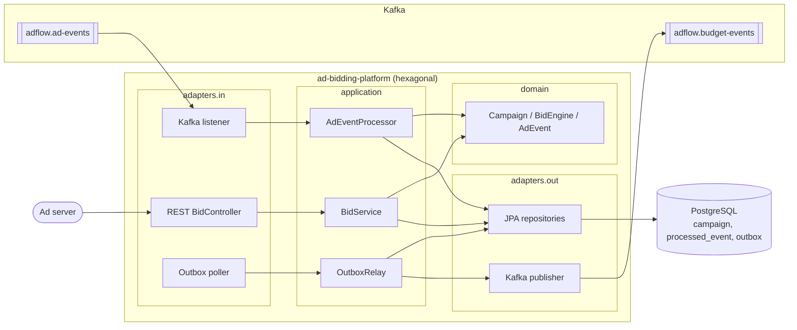

# AdFlow Ad Bidding Platform

## What this is

A reference implementation of the core of a (fictional) sponsored-product ad platform, "AdFlow":

- Consumes impression and click events from Kafka (`adflow.ad-events`) with an **idempotent consumer**.
- Keeps **per-campaign budget accounting** in PostgreSQL.
- When a budget is exhausted, emits `BudgetExhausted` to `adflow.budget-events` through a **transactional outbox**.
- Serves `POST /v1/bids`: picks the winning campaign by keyword match and max bid, returning the bid and remaining budget (OpenAPI via springdoc at `/swagger-ui.html`).

Java 21, Spring Boot 3.3, Maven, JPA + Flyway, hexagonal architecture. Event schemas follow
[`shared/contracts/ad-events.asyncapi.yaml`](../../shared/contracts/ad-events.asyncapi.yaml). All data is synthetic.

## Experience this project reflects

This project condenses patterns from 20+ years of building backend systems, most recently:

- **Event-driven microservices with Kafka and Pub/Sub at ad-platform scale**: high-volume impression, click and budget streams, partitioned by campaign so ordering holds where it matters.
- **Resilient, idempotent consumers**: at-least-once delivery is the reality, so correctness comes from persisted dedupe and atomic state changes, not from hoping the broker never redelivers.
- **Near-real-time processing**: budgets must stop spending quickly, so the path from event to `BudgetExhausted` is short and measurable.
- **Spring Boot / Spring Cloud services on Kubernetes**: stateless services, health endpoints, externalised config, safe to scale horizontally (note the `SKIP LOCKED` outbox polling and per-row campaign locks).
- **CI quality gates with SonarQube**: tests, architecture rules and static analysis fail the build before code merges (see `.github/workflows/ad-bidding-platform.yml` at the repo root).

## Architecture



Processing one event is a single DB transaction: insert `processed_event` (dedupe), lock and charge the campaign, and, if the budget just hit zero, insert the `outbox` row.

## Key design decisions & trade-offs

| Decision | Why | Trade-off |
|---|---|---|
| Persisted dedupe on `eventId` ([ADR 1](docs/adr/0001-idempotent-consumer.md)) | Safe under redelivery and restarts | Dedupe table needs retention; extra write per event |
| Transactional outbox ([ADR 2](docs/adr/0002-transactional-outbox.md)) | No dual-write loss between DB and Kafka | At-least-once output; latency = poll interval |
| Hexagonal + ArchUnit ([ADR 3](docs/adr/0003-hexagonal-architecture.md)) | Pure, fast domain tests; swappable transports | More mapping code |
| Pessimistic row lock per campaign | Simple, correct under concurrent consumers | Lower throughput on hot campaigns than sharded counters |
| Spend capped at budget; exhaustion reported once | Idempotent state transition | Overspend by in-flight events is not tracked |
| Manual JSON parsing, poison messages skipped | One bad record cannot block a partition | Needs a dead-letter topic in production |
| Bid = min(max bid, remaining budget) | Never bids more than can be paid | Does not model pacing or second-price auctions |

## How to run

```bash
make up     # Kafka (KRaft) + Postgres via docker compose
make run    # start the service on :8080 (Flyway migrates and seeds 3 demo campaigns)
make down   # stop and remove containers
```

Try it:

```bash
curl -s localhost:8080/v1/bids -H 'content-type: application/json' -d '{"keywords":["sneakers"]}'
# {"won":true,"campaignId":"cmp-1001","bidCents":120,"remainingBudgetCents":50000}
```

Swagger UI: http://localhost:8080/swagger-ui.html

## How to test

```bash
make test   # = mvn -B verify
```

- Domain unit tests (JUnit 5, no Spring) and an application-service test with in-memory fakes.
- `HexagonalArchitectureTest` (ArchUnit) enforces the dependency rules.
- `AdBiddingIT` (Testcontainers: Postgres + Kafka) covers duplicate delivery, budget exhaustion and the outbox end to end. It is skipped automatically when Docker is unavailable (`disabledWithoutDocker = true`).

## What I would do next in production

- **Pub/Sub vs Kafka**: this repo uses Kafka only; on GCP the same ports would get a Pub/Sub adapter (ordering keys, ack deadlines, different redelivery semantics). The hexagonal split makes that an adapter change, but it is not implemented here.
- **Schema registry and evolution**: payloads are plain JSON validated by hand against the AsyncAPI contract. I would use Avro/Protobuf with a registry and compatibility checks in CI.
- **Exactly-once caveats**: delivery is at-least-once with effectively-once processing through dedupe. Kafka transactions do not cover the Postgres write, and the outbox can publish a message twice, so downstream consumers must dedupe too.
- **Dead-letter topic and retry policy** with backoff for malformed or failing records.
- **Dedupe retention**, partitioning of `processed_event`, and replacing the polling outbox with CDC at higher volume.
- **Hot-campaign throughput**: sharded or Redis-backed budget counters with periodic reconciliation; budget pacing; reservation of budget at bid time.
- **Observability and delivery**: metrics (consumer lag, outbox age), tracing, Kubernetes manifests/Helm, SonarQube quality gate in CI, and load tests.
- The Testcontainers test was written but, in my authoring environment, Docker was unavailable, so it ran as skipped; run it where Docker is available.
