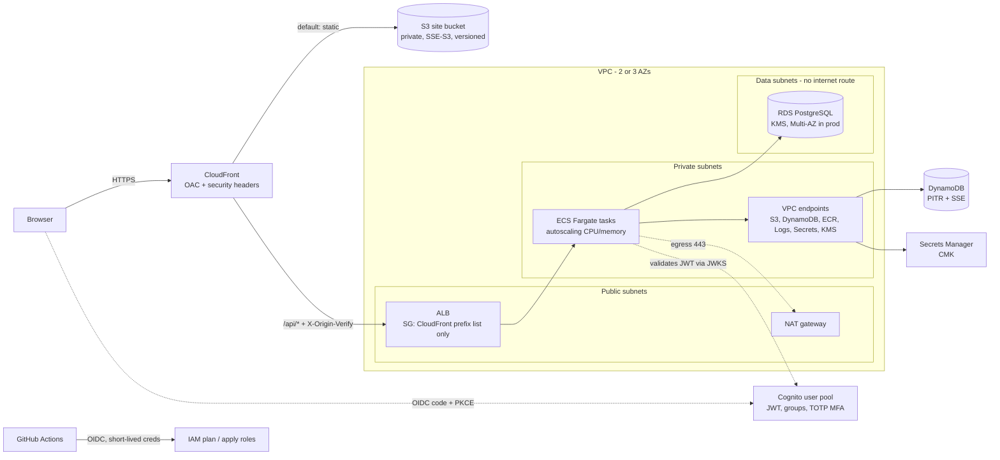

# Learning Platform on AWS (Terraform baseline)

A reusable Terraform baseline for a highly available web + API platform on AWS, composed in two example environments (`dev`, `prod`). The workload is generic and fictional: a learning platform (AdFlow-style naming) with a static SPA, a containerised API, a relational database and per-learner progress data. All names, ARNs and account ids are placeholders.

## What this is

- **Nine reusable modules** in `modules/`: `vpc`, `alb`, `ecs-fargate-service`, `cloudfront-s3-static-site`, `rds-postgres`, `dynamodb`, `cognito-user-pool`, `secrets`, `iam-github-oidc`.
- **Two environments** in `envs/dev` (cheap, single NAT, single-AZ database) and `envs/prod` (3 AZs, NAT per AZ, interface VPC endpoints, RDS Multi-AZ, deletion protection, HTTPS to the origin).
- A **remote-state bootstrap** in `backend/` (S3 + DynamoDB lock), documented and **not applied**.
- A **GitHub Actions example** (`ci.yml.example`) using OIDC, a `Makefile`, `.tflint.hcl`, `.checkov.yaml`, three ADRs in `docs/adr/`.

## Experience this project reflects

Designing high-availability AWS architectures with ECS Fargate, EC2 Auto Scaling, CloudFront, RDS and DynamoDB; leading Infrastructure-as-Code adoption with Terraform (modules, environments, state, review gates); build and deploy automation with CodePipeline and GitHub Actions; security reviews of IAM and Secrets Manager usage; and Cognito/JWT based authentication. This is a reference implementation of patterns, not a record of any specific production system. EC2 Auto Scaling is discussed in [ADR 0001](docs/adr/0001-ecs-fargate-over-ec2-and-eks.md) but not implemented here.

## Architecture



Request path: CloudFront -> (static from S3 | `/api/*` to ALB) -> ECS tasks in private subnets -> RDS in isolated subnets, DynamoDB via gateway endpoint.

### Module wiring (envs)

`vpc` -> `alb` (public subnets, VPC CIDR) -> `ecs-fargate-service` (private subnets, ALB SG, target group) -> `rds-postgres` (data subnets, allows only the service SG). The service receives Cognito issuer/client id, DynamoDB table name and DB coordinates as plain env vars, and DB credentials plus an app key as injected secrets. `cloudfront-s3-static-site` fronts both, and `iam-github-oidc` provides the CI roles.

## Security decisions

| Area | Decision |
|---|---|
| Network | Three tiers. Tasks and DB have no public IPs; data subnets have no internet route; default security group is emptied. Gateway endpoints (S3, DynamoDB) always; interface endpoints (ECR, Logs, Secrets Manager, KMS) in prod. |
| Edge | S3 bucket fully private, read only via CloudFront OAC scoped to the distribution ARN; TLS-only bucket policy; ALB admits only the CloudFront prefix list **and** requires a secret header ([ADR 0002](docs/adr/0002-cloudfront-origin-lockdown.md)). |
| Encryption at rest | RDS and Performance Insights with a CMK (rotation on); Secrets Manager with a CMK; DynamoDB SSE (AWS-managed key by default, CMK optional); S3 SSE; state bucket SSE-KMS. In transit: `rds.force_ssl=1`, HTTPS viewer policy, TLS 1.3 policy on the ALB in prod. |
| IAM | Separate ECS execution role (read only the injected secret ARNs, decrypt only their keys) and task role (item-level DynamoDB on one table, from a generated policy). CI via GitHub OIDC with `aud`/`sub` conditions; plan role read-only, apply role restricted to a protected environment ([ADR 0003](docs/adr/0003-secrets-and-identity.md)). |
| Secrets | RDS-managed master password (never in code or state). Generated app secrets are in state, which is documented as a trade-off. |
| Identity | Cognito: PKCE code flow, no client secret for the SPA, user-existence errors hidden, token revocation on, optional TOTP MFA, groups. |
| Supply chain | ECR with immutable tags and scan on push. Images are referenced by tag from a repo created by the stack. |
| Known gaps | No WAF, no CloudFront/ALB access logs, no VPC flow logs, no GuardDuty/Config, no log-group CMK. Listed as next steps; `.checkov.yaml` skips the related checks explicitly. |

## Cost & trade-offs

Rough, order-of-magnitude monthly figures for `us-east-1`, list prices, light traffic; treat as planning hints and check the AWS Pricing Calculator.

| Item | dev | prod | Notes |
|---|---|---|---|
| NAT gateways | 1 (~$33 + data) | 3 (~$100 + data) | Largest fixed cost in dev. Gateway endpoints are free and keep S3/DynamoDB off NAT. |
| Interface endpoints | off | on (5 services x 3 AZs, ~$110) | Pay off with heavy ECR/Logs/Secrets traffic or compliance rules against NAT egress; for low traffic NAT alone is cheaper. Toggle with `enable_interface_endpoints`. |
| ALB | ~$20 | ~$25+ | Plus LCUs. |
| Fargate (ARM64) | 1 x 0.25 vCPU/0.5 GB ~ $9 | 3-12 x 0.5 vCPU/1 GB ~ $55-$220 | Autoscaling cost follows load. |
| RDS PostgreSQL | db.t4g.micro single-AZ ~ $13 | db.m6g.large Multi-AZ ~ $250 | Multi-AZ doubles instance cost; buys automatic failover in 1-2 minutes. |
| DynamoDB | on-demand, ~pennies | on-demand | Switch to provisioned + autoscaling when traffic is steady. |
| CloudFront / S3 | small | PriceClass_200 | Egress dominates at scale. |
| KMS / Secrets Manager | few $ | few $ | $1 per key/month, $0.40 per secret/month. |

Trade-offs worth knowing: single NAT in dev is not AZ-resilient (acceptable for dev); the CloudFront-to-ALB shared secret is simple but needs a rotation procedure; Fargate costs more per vCPU than packed EC2 ([ADR 0001](docs/adr/0001-ecs-fargate-over-ec2-and-eks.md)); `PriceClass_100/200` cut cost by excluding some edge locations.

## How to use

Prerequisites: Terraform >= 1.6, an AWS account and credentials with rights to create the resources. Nothing here has been applied.

```bash
# 1. (once per account) bootstrap remote state, with local state and admin credentials
cd backend && terraform init && terraform apply -var bucket_name=<your-unique-bucket>
#    note the output ARNs; they feed state_bucket_arn / lock_table_arn

# 2. configure an environment
cd ../envs/dev
cp backend.tf.example backend.tf          # edit bucket/table placeholders
cp terraform.tfvars.example terraform.tfvars   # edit placeholders (git-ignored)

# 3. review the plan
make -C ../.. plan ENV=dev
```

Other targets: `make fmt`, `make fmt-check`, `make validate` (init `-backend=false` + validate for each env), `make lint` (tflint), `make security` (checkov), `make check` (all of them). Apply is intentionally not a Makefile target: run it deliberately, or from a protected CI environment.

Push an image to the ECR repository created by the stack (`ecr_repository_url` output), build for `linux/arm64`, listening on 8080 with `/healthz`. The container root filesystem is read-only by default; mount a writable volume or set `read_only_root_filesystem = false` if your app needs it.

CI: copy `ci.yml.example` to `.github/workflows/ci.yml`, deploy the `iam-github-oidc` module, and set the plan role ARN as a repository variable. It runs `fmt`, `validate`, `tflint`, `checkov` and `plan` with short-lived OIDC credentials.

Not covered by the SPA: single-page-app deep links (a CloudFront Function rewriting unknown paths to `/index.html` is the usual fix).

## What was and wasn't validated

- **Not run: `terraform fmt`, `init`, `validate`, `plan`, `apply`, `tflint`, `checkov`.** Terraform, tflint and checkov were not available in the authoring environment, and downloading them was blocked (network allow-list); Docker was not accessible either. **No claim is made that this code passes `terraform validate` or `fmt -check`, or that it deploys.** Run `make check` before relying on it.
- What was done: a careful manual review, plus a script-based static check of the module wiring: balanced braces in every `.tf` file; every module argument used by `envs/*` exists as a variable, every required variable is supplied, every `module.x.y` output reference exists; every `var.*`, `local.*`, resource and data reference inside each module resolves to a declaration. This catches typos and wiring mistakes, not provider-schema errors (wrong argument names, invalid values), which only `validate` finds.
- Likely first-run adjustments: the `.checkov.yaml` skip ids were written from memory; the `rds-postgres` engine version and `tflint` AWS plugin version are pinned defaults that may need bumping; attribute alignment may need a `terraform fmt`.
- Next steps for production: WAF, access logs, flow logs, GuardDuty/Config, log-group CMKs, a scoped apply policy, two-secret rotation of the origin header, RDS Proxy if connection counts grow, and a DNS/ACM module.
