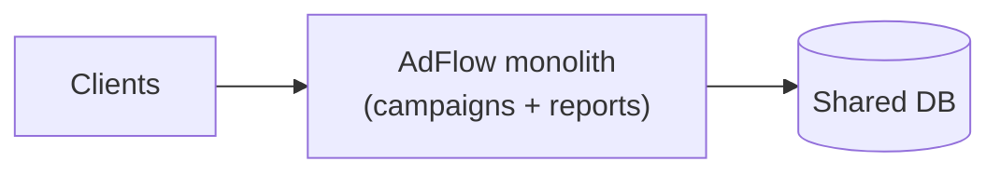
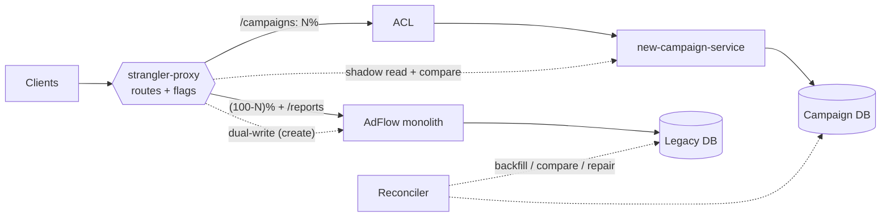
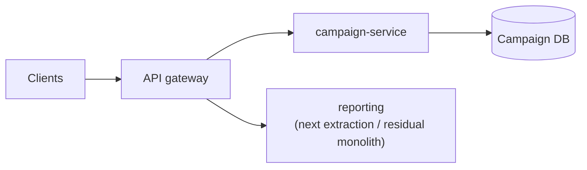

# Monolith to Microservices: Strangler Fig Demo

## What this is

A small, runnable demonstration of the **strangler fig pattern** on a fictional legacy "AdFlow" campaign-management monolith. Java 21, Maven, JDK built-in `HttpServer` plus Jackson (no Spring, so the build stays fast and the mechanics stay visible). All data is synthetic.

| Module | Role |
|---|---|
| `legacy-monolith` | Deliberately tangled monolith: `/campaigns` and `/reports` welded to one shared in-memory "DB", mainframe-style fields (`CAMP_NM`, `STAT_CD`), `CHAR(20)` name truncation, error codes instead of HTTP semantics |
| `new-campaign-service` | The extracted service that owns campaigns, with a clean model (minor-unit money, ISO dates, enum status) |
| `strangler-proxy` | Routing facade: per-route percentage routing (feature-flag style, changeable at runtime), parallel run with mismatch log, dual-write, automatic fallback, data backfill and reconciliation |
| `common` | The **anti-corruption layer** (`CampaignAcl`), both models, field-level diff |

## Experience this project reflects

Condenses patterns from 23 years of backend work, including leading migrations of monolithic JEE applications (WebSphere, WebLogic, JBoss, Glassfish) into Spring Boot / Spring Cloud microservices on Kubernetes and AWS in financial and enterprise contexts:

- Incremental, reversible migration instead of big-bang rewrites, with traffic shifted behind a facade.
- Defining **centralized data-access components** so that shared-database coupling could be untangled one bounded context at a time.
- Anti-corruption layers to keep legacy vocabulary out of new services.
- Process improvement: parallel run, reconciliation and explicit cutover/rollback criteria as part of the delivery routine.

## Architecture: before / during / after

**Before.** Clients call the monolith directly; campaigns and reports share one schema.



**During.** The proxy owns routing. Reads are split by percentage, writes are dual-written, the other side is shadowed to compare answers, and the ACL translates between models.



**After.** Legacy campaign code is deleted; the proxy shrinks to an API gateway; reports are the next candidate.



## Playbook summary

Full version in [`docs/playbook.md`](docs/playbook.md); decisions in [`docs/adr/`](docs/adr/).

1. **Assess and map** the domain into DDD bounded contexts; pick the first slice by value, risk and coupling.
2. **Find seams** (HTTP, DB, batch) and put a facade in front.
3. **Build the ACL** and the new service; **backfill** data.
4. **Parallel run**: shadow reads and compare, reconcile data.
5. **Shift** 0 -> 5 -> 25 -> 50 -> 100%, watching error rate, latency and mismatch rate.
6. **Cut over writes**, keep reverse sync for rollback, then **decommission** legacy code.

## How to run

Requires Java 21 and Maven.

```bash
mvn verify                 # 17 JUnit 5 tests: routing, parallel run, ACL, reconciliation, end-to-end
make demo                  # builds fat jars, starts legacy:8081, new:8082, proxy:8080, shifts 0% -> 50% -> 100%
make demo MVN="mvn -s /path/to/settings.xml"   # if you need a custom Maven settings file
```

The demo shows: routing at 0%; migration + clean reconciliation; dual-write; drift injected behind the proxy and caught by the shadow comparison and by reconciliation, then repaired; 50% and 100% distributions over 40 users; reports still served by the monolith; killing the new service triggers automatic fallback; rollback with one config change.

Proxy admin API: `GET/POST /admin/routes?prefix=/campaigns&percent=50&shadow=true`, `GET/DELETE /admin/mismatches`, `POST /admin/migrate`, `GET /admin/reconcile?repair=true`, `GET /admin/status`. Static config: `strangler-proxy/routing.properties`.

## Trade-offs

- Routing is **sticky by key** (hash of `X-Routing-Key` / campaign id), so a user sees consistent behaviour and raising the percentage only moves keys legacy -> new.
- Dual-write is simple but not atomic: a failed secondary write is counted and left to reconciliation. Production would use an outbox / CDC (see ADR 002).
- The legacy remains system of record until cutover; repair never deletes rows that exist only in the new store.
- The known `CHAR(20)` truncation is tolerated by the comparison; every such tolerance hides potential real drift and must be explicit and reviewed.
- In-memory stores and a single proxy process: no persistence, auth or HA. The goal is to show the mechanics, not a production gateway.
- Shadow reads double read load on the backends during parallel run.

## Not verified

- Behaviour under real load, network partitions or multi-instance proxies.
- Real JEE app server, database and Kubernetes/AWS deployment (all simulated with in-memory stores and local processes).
- Write-path parallel run (only reads are shadowed) and concurrent-writer conflicts during dual-write.
