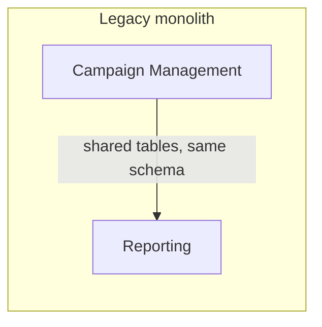
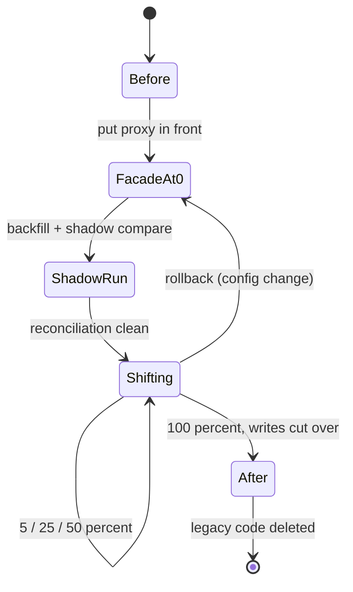

# Migration playbook: monolith to microservices with the strangler fig

A step-by-step guide distilled from enterprise JEE migrations (application-server monoliths moving to Spring Boot / Spring Cloud on Kubernetes), illustrated by the code in this repository.

## 0. Principles

- Migrate **capabilities**, not layers; every step ships and is reversible.
- The monolith stays the system of record until a slice is proven.
- Never share a database between a new service and the monolith for long. If you must, do it behind a data-access component with a single owner.
- Measure first, then move.

## 1. Assess and map the domain (DDD bounded contexts)

1. Inventory: modules, endpoints, batch jobs, tables, integrations, deployment units (EAR/WAR), owners.
2. Event-storm or interview to name the **bounded contexts** and their ubiquitous language. In AdFlow: *Campaign Management*, *Reporting*, (later) *Budgeting*, *Delivery*.
3. Draw the context map: who is upstream/downstream, where terminology differs. Differences mark the **anti-corruption layer** locations.
4. Score each candidate slice: business value, change frequency, coupling (shared tables, call graph), data volume, risk, team readiness. Prefer high change frequency with low coupling for the first slice; pick something real but not the crown jewels.
5. Capture the hidden behaviour with **characterization tests** on the legacy (the quirks are requirements until proven otherwise).

## 2. Find the seams

| Seam | Example | Technique |
|---|---|---|
| HTTP / RPC | `/campaigns` | Routing proxy, route per prefix |
| Database | Report reads campaign table | Data-access component, then API/event, then own store |
| Batch / scheduler | Nightly job edits rows | Route through the new owner, or reconcile |
| Messaging | Shared queues/topics | Dual-publish, then switch consumers |
| Session / security | Container-managed auth | Token relay at the proxy |

Put the facade in front **before** extracting anything; at 0% it is a transparent pass-through and proves the proxy itself is safe.

## 3. Sequencing

1. Facade at 0% (no behaviour change). 2. Extract the leaf-most context with the cleanest seam (campaigns). 3. Reporting last: it depends on everyone's data, so it benefits from events/CDC read models. 4. Decommission legacy code per slice, not at the end.

Rule of thumb: never have more than one or two slices in flight per team.

## 4. Build the new service and the ACL

- The new model is designed for the new context, not translated 1:1.
- All translation lives in one **ACL** (`CampaignAcl`): codes (`A/S/C` -> enum), money (string major units -> integer minor units), dates (`yyyyMMdd` -> ISO), padding. It rejects corrupt data loudly instead of passing it on.
- Legacy limitations (CHAR(20) truncation) are documented and, where tolerated, tolerated in exactly one place.

## 5. Data strategy

1. **Backfill** through the ACL (idempotent).
2. **Keep in sync**: dual-write (demo) or outbox/CDC (production). See ADR 002.
3. **Reconcile** on a schedule and before every traffic increase; define "clean" as zero unexplained mismatches.
4. **Cutover writes**: flip the primary, keep reverse sync for the rollback window.
5. **Retire**: stop reverse sync, archive and drop legacy tables only after the window closes.

Watch for: id allocation (the demo uses disjoint id ranges), time zones and rounding, sequences, deletes (tombstones), and unmanaged writers such as batch jobs and DBA scripts.

## 6. Parallel run and traffic shifting

1. **Shadow**: serve from legacy, call the new service too, compare, log mismatches (never affect the client).
2. Fix mismatches or classify them as accepted differences.
3. **Shift** by percentage with sticky keys: 1 -> 5 -> 25 -> 50 -> 100%, soaking at each stage.
4. Gate each step on metrics (section 8). Keep the legacy path warm for rollback.

## 7. Rollback

- **Traffic rollback**: set the route to 0%. Takes seconds, no deploy.
- **Automatic fallback**: new-service errors fall back to the legacy for the request; alert on the fallback rate.
- **Data rollback**: reverse sync keeps legacy current; verify with reconciliation before relying on it.
- Rehearse the rollback in every stage; an untested rollback is a hope.

## 8. Metrics and gates

| Metric | Gate example |
|---|---|
| Error rate (new vs legacy) | new <= legacy |
| p95/p99 latency | within agreed budget, proxy hop included |
| Parallel-run mismatch rate | 0 unexplained over N days |
| Reconciliation drift | 0 unexplained before each increase |
| Fallback and dual-write failure counts | alert on any sustained non-zero |
| Share of traffic on new | progress indicator per route |
| Legacy code/tables deleted | the real definition of done |

## 9. Team and organizational aspects

- Align teams to bounded contexts (Conway's law works for or against you); one team owns each service and its data.
- Create an **ownership map** for the legacy so every route has a named owner and a decommission date.
- Keep a migration working group (architect, QA, ops, product) with a shared dashboard and a weekly review of gates.
- Platform first: CI/CD, observability, config and secrets management should exist before the second service.
- Communicate with business stakeholders in terms of risk retired and value delivered per slice.
- Invest in training (Spring Boot/Cloud, containers, observability) and pair legacy veterans with newcomers: they know the quirks.

## 10. Common anti-patterns

- **Big-bang rewrite**: long dark period, no feedback.
- **Distributed monolith**: services sharing a database or calling each other synchronously in chains.
- **Nano-services** cut by technical layer instead of by bounded context.
- **No ACL**: legacy vocabulary leaks into the new model, so you rebuild the monolith in new clothes.
- **Forever dual-write**: the migration never finishes; set an end date.
- **Skipping reconciliation**: drift found by customers.
- **Proxy as new monolith**: business logic creeping into the routing layer.
- **Migrating the easy parts only**: the hard core stays, and the cost of running both systems grows.
- **Never deleting legacy code**: unfinished slices become permanent.

## 11. Per-slice checklist

- [ ] Context and seam identified, characterization tests in place
- [ ] Facade route at 0%, metrics visible
- [ ] ACL and new service built, contract tests green
- [ ] Backfill done, reconciliation clean
- [ ] Shadow comparison clean over the agreed period
- [ ] Shifted to 100% with rollback rehearsed
- [ ] Writes cut over, reverse sync window closed
- [ ] Legacy code and data removed, runbook and ownership updated

## Appendix: states of the system

