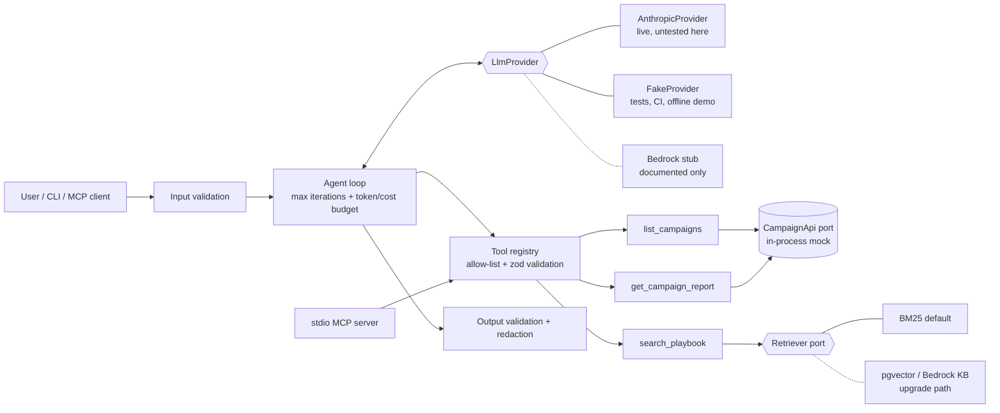

# AdFlow Ads Analyst Agent (Claude + tools + RAG + MCP)

An agent that answers natural-language questions about ad campaign performance ("which campaign has the best CTR?", "how can I improve CTR?"). It runs against **AdFlow**, a fictional ad platform with synthetic data. Everything runs offline by default; a live Anthropic provider is included but is **not exercised in this repo's tests or CI**.

## What this is

- A **manual agentic tool-use loop** (TypeScript, Node 20+, strict) with an iteration cap and a token/cost budget guard.
- Three read-only tools: `list_campaigns`, `get_campaign_report`, `search_playbook` (RAG).
- A dependency-free **BM25 retriever** over synthetic markdown best-practice docs, behind a pluggable `Retriever`/`Embedder` interface.
- **Guardrails**: input/output validation, zod tool-argument validation, tool allow-list, read-only tools, log redaction, untrusted-tool-output stance.
- A **stdio MCP server** exposing the same tools to any MCP client.
- An `LlmProvider` interface with an **Anthropic** implementation (official `@anthropic-ai/sdk`), a deterministic **FakeProvider**, and a documented **Bedrock stub**.
- An **eval harness** with golden cases (pass rate, tokens, latency, estimated cost).
- An in-process **mock of the AdFlow Campaign API** (`shared/contracts/campaign-api.openapi.yaml`, read-only subset).

## Experience this project reflects

It is a compact demonstration of the kind of work involved in shipping production LLM and agent features: integrating Anthropic Claude APIs and Amazon Bedrock into enterprise applications, applying RAG patterns, choosing between hand-written agent loops and agent frameworks, using APIs securely and with cost awareness (budgets, caching, redaction, least privilege), and AI-assisted engineering (this project was built with an AI coding assistant, then reviewed and verified by running the checks below). It is a reference implementation of patterns, not a record of any specific production system.

## Architecture



Layout: `src/agent` (loop, cost), `src/providers`, `src/tools` (registry shared by agent and MCP), `src/rag`, `src/guardrails`, `src/data` (mock API), `src/mcp`, `docs/playbook` (RAG corpus), `evals/`, `tests/`.

### RAG and the upgrade path
`loadMarkdownChunks` splits docs per `##` section. `Bm25Retriever` is the default (no service needed). Two seams exist for production: implement `Retriever` directly (for example a `BedrockKnowledgeBaseRetriever` calling the Bedrock Agent Runtime `Retrieve` API), or implement `Embedder` and use `VectorRetriever`-style logic backed by **pgvector** (store `embedding vector(n)` per chunk, query with cosine distance, hybrid with BM25 for keyword recall). Neither upgrade is implemented here; `VectorRetriever` is a small in-memory illustration tested with a toy embedder.

### Providers
- `AnthropicProvider`: Messages API, default model `claude-sonnet-5-5` (override with `AGENT_MODEL`), prompt caching on tools and system prompt, `tool_choice` left on auto. Key read from `ANTHROPIC_API_KEY` only.
- `FakeProvider`: replays scripted responses (or functions of the request). `demoAnalystScript` is a deterministic stand-in "analyst" used by the offline CLI and fake-provider evals. It proves the plumbing, **not** model quality.
- `src/providers/bedrock.stub.ts`: documented mapping to the Bedrock Converse API; throws if called.

## Safety & cost controls

| Control | Where |
|---|---|
| Max iterations (default 6), max total tokens (60k), max estimated cost ($0.25), checked before every model call | `src/agent/loop.ts`, env `AGENT_MAX_*` |
| Per-call `max_tokens` cap, tool result size cap (6k chars) | loop / registry |
| Prompt caching on the stable prefix (tools, system) | `AnthropicProvider` |
| Tool allow-list; unknown tools rejected | `executeTool` |
| zod `.strict()` argument validation; errors returned to the model as `is_error` results | `src/tools/registry.ts` |
| Read-only by construction: the `CampaignApi` port has no write methods | `src/data` |
| Input validation (type, length, control chars); output validation (size, redaction) | `src/guardrails/validate.ts` |
| Regex redaction of emails, phones, long numbers, API keys, bearer tokens in logs and answers | `src/guardrails/redact.ts` |
| Prompt-injection stance | see below |

**Prompt injection.** Tool results (campaign names, keywords, playbook text) are untrusted data. The system prompt says so, tools are read-only so a hijacked model cannot write, and a heuristic logs suspected injections. The mock data contains a deliberately hostile campaign name that tests exercise. These are mitigations, not a guarantee: a prompt cannot be relied on as the only defense, which is why privileges are minimal.

**Cost numbers are estimates.** Prices default to Sonnet-class list prices at the time of writing ($2 / $10 per 1M tokens in/out) and cache multipliers are assumptions; override via `PRICE_*` env vars and verify against current pricing.

## Evals

`evals/cases.json` holds golden cases graded programmatically (required tool calls, required/forbidden answer substrings, clean stop). `npm run eval` prints per-case pass/fail, tokens, latency and estimated cost, plus a summary, and exits non-zero below a threshold (100% for fake, 75% default for live, `EVAL_MIN_PASS_RATE` to override).

- With `--provider fake` it is deterministic and runs in CI. Tokens and cost there are character-based approximations and latency is meaningless.
- With `--provider anthropic` (requires `ANTHROPIC_API_KEY`) the same cases run against the real model. **This path has not been run.** Four cases is a smoke test, not a benchmark.

## How to run

```bash
npm install

# Offline (no key, no network): FakeProvider
npm run ask -- "which campaign has the best CTR?"
npm run ask -- --verbose "how can I improve CTR?"
npm run eval -- --provider fake

# With a real key (UNTESTED by the author's verification run)
cp .env.example .env   # then export ANTHROPIC_API_KEY in your shell; never commit it
export ANTHROPIC_API_KEY=...
npm run ask -- --provider anthropic "which campaign has the best CTR?"
npm run eval -- --provider anthropic

# MCP server over stdio
npm run mcp
```

Without `--provider`, the CLI uses Anthropic if `ANTHROPIC_API_KEY` is set, otherwise the fake provider. MCP client config example:

```json
{ "mcpServers": { "adflow-analyst": { "command": "npx", "args": ["tsx", "src/mcp/server.ts"], "cwd": "<path to this project>" } } }
```

`make ci` runs install, typecheck, tests and fake evals. `.github/workflows/ai-agents-claude.yml` at the repo root is the GitHub Actions workflow (already wired with a path filter).

## How to test

```bash
npm run typecheck
npm test
```

Covered, with no key and no network: agent loop (tool then final answer, iteration cap, token budget, cost budget, validation errors fed back, allow-list rejection, redaction, hostile tool data), tool-argument rejection, BM25 ranking and the pluggable vector retriever, MCP tool listing and calls through an in-memory transport, and the eval harness with the FakeProvider (including failure detection).

## Honest limits and production next steps

- **The live Anthropic path is unverified here.** It was written from SDK documentation and type-checks, but it was never run against the API. The `thinking`/`output_config` fields are cast past the pinned SDK types and may need adjusting for your SDK/model version.
- The fake "analyst" is scripted code; passing fake evals says nothing about model behavior.
- The mock API has 6 synthetic campaigns and no auth, date ranges or real pagination semantics beyond the contract. A production client needs bearer auth, timeouts, retries, and per-user scoping (the agent must act with the caller's permissions, not a god token).
- BM25 on 5 short docs is a demo. Real corpora need chunking strategy, hybrid retrieval, reranking, citations and retrieval evals.
- Redaction is regex-based and will miss things; use a proper DLP/PII service for regulated data.
- Token counting is taken from API usage after each call, so a single call can overshoot a budget; the guard stops the next call. Cost uses assumed prices.
- No streaming, no conversation memory across questions, no concurrency limits or rate-limit backoff beyond SDK defaults.
- Next steps: live eval runs with LLM-as-judge or rubric graders over a larger set, tracing/observability, Bedrock provider (validate tool-use parity), Knowledge Bases or pgvector retrieval, human approval for any future write tools, and a prompt-injection red-team set.
