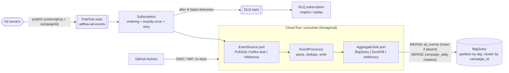

# AdFlow GCP Event Pipeline

## What this is

The Google Cloud counterpart to the Kafka-based [ad bidding platform](../02-ad-bidding-platform/README.md) for the
(fictional) "AdFlow" ad platform. It turns impression and click events into per-campaign, per-day analytics:

- Pub/Sub topic and subscription (ordering key = `campaignId`, dead-letter topic, exactly-once delivery enabled and discussed honestly below).
- Java 21 / Spring Boot 3.3 consumer, **idempotent**, with swappable adapters behind ports: Pub/Sub, Kafka (stub) and in-memory sources; BigQuery, DuckDB and in-memory sinks.
- BigQuery tables partitioned by day and clustered by `campaign_id`, loaded with **idempotent MERGE** statements (`sql/`).
- Terraform (google provider) for topics, subscription, DLQ, dataset and tables, Cloud Run, least-privilege service accounts and Workload Identity Federation for GitHub Actions.

Events follow [`shared/contracts/ad-events.asyncapi.yaml`](../../shared/contracts/ad-events.asyncapi.yaml). All data is synthetic; all project ids are placeholders.

## Experience this project reflects

This project condenses patterns from 20+ years of building backend systems, most recently:

- **Event-driven ad-serving services on GCP**: GKE and Cloud Run services consuming Pub/Sub and feeding BigQuery.
- **Kafka and Pub/Sub side by side**: choosing, operating and migrating between them (see [docs/kafka-vs-pubsub.md](docs/kafka-vs-pubsub.md)).
- **Resilient, idempotent consumers**: at-least-once is the reality, so correctness comes from idempotent writes, bounded retries and dead-lettering, not from broker promises.
- **Cost-aware analytics**: partition pruning, clustering and enforced partition filters so queries cannot silently scan everything.

## Architecture



Processing one message: strict parse (poison goes to the DLQ path by nack) -> in-memory dedupe fast path -> sink write. The sink is the authority: raw events are inserted only if `event_id` is absent and aggregates are recomputed (replaced, never incremented) for the touched campaign/day, so replays and backfills converge ([ADR 1](docs/adr/0001-idempotency-layers.md), [ADR 2](docs/adr/0002-ports-and-adapters.md)).

### Design decisions and trade-offs

| Decision | Why | Trade-off |
|---|---|---|
| Idempotent sink + cache fast path | Correct after restarts and scale-out | Recompute per touched day; per-message MERGE is costly, micro-batch in production |
| Ordering key = campaignId | Per-campaign order like the Kafka key | A nacked message blocks its key until redelivery or DLQ |
| Exactly-once delivery enabled | Fewer redeliveries after acks | Pull-only, regional, ack can fail; producers can still duplicate. Not end-to-end exactly-once |
| `require_partition_filter` on tables | Unbounded scans fail instead of billing | Every query must carry a date predicate |
| Cloud Run with min 1 instance, CPU always on | Streaming pull needs a live process | Pays for idle; GKE or a push subscription are alternatives |
| Dataset-level `dataEditor` + project `jobUser` | Least privilege that still runs MERGE | Project-level `jobUser` cannot be scoped tighter |

## Kafka vs Pub/Sub

Short version: Kafka gives you a replayable log and per-partition order at the price of running (or paying for) capacity; Pub/Sub gives managed fan-out, built-in dead-lettering and per-key ordering with almost no ops, but weaker replay. Full comparison, migration lessons and the AWS mapping (SNS/SQS, Kinesis, Athena) are in [docs/kafka-vs-pubsub.md](docs/kafka-vs-pubsub.md).

## How to run

```bash
make verify       # mvn -B verify: unit, contract, ArchUnit tests (emulator IT skipped without Docker)
make run          # in-memory source and sink; health at http://localhost:8080/actuator/health
make tf-fmt       # tofu fmt -check -recursive
make docker-build # image for Cloud Run
```

Switch adapters with env vars: `ADFLOW_SOURCE=memory|pubsub|kafka`, `ADFLOW_SINK=memory|duckdb|bigquery`
(plus `GCP_PROJECT`, `PUBSUB_SUBSCRIPTION`, `BQ_DATASET`, optional `PUBSUB_EMULATOR_HOST`). Deploy: set the Terraform variables
(placeholders by default), `tofu apply`, push the image, then use [`ci.yml.example`](ci.yml.example) as a starting point.

Tests: `DomainTest`, `EventProcessorTest`, `AggregateSinkContract` (one abstract suite run against `InMemoryAggregateSinkTest` and `DuckDbAggregateSinkTest`), `SqlFilesTest`, `ArchitectureTest` (ArchUnit), and `PubSubEmulatorIT` (Testcontainers, skipped without Docker).
SQL: `sql/01_merge_ad_events.sql`, `sql/02_merge_campaign_daily.sql`, `sql/03_cost_aware_query.sql`.

## Not verified

> **Update — verified in GitHub Actions** (workflow `iac-and-platform-validate`, runs on every push): `terraform fmt`/`init`/`validate` pass, and the `gcp-event-pipeline` workflow runs `mvn verify` on a runner with Docker, so the Pub/Sub emulator integration test runs there. The BigQuery sink and SQL were still never executed against real BigQuery. The bullets below are from the original local session.

- `mvn verify` passes: 22 tests, plus the Pub/Sub emulator IT **skipped** because Docker was unavailable here. It compiles but has never run.
- `BigQueryAggregateSink` and the BigQuery SQL were **never executed** against BigQuery (no project/credentials). DuckDB validates the idempotency contract and the SQL shape only; BigQuery dialect details (JSON functions, parameter typing) are unproven.
- Terraform: `tofu fmt -check -recursive` passes. `tofu init`/`validate` could not run (provider registry returned 403), so resources, argument names and provider-version compatibility are unvalidated; nothing was planned or applied.
- Dockerfile and `ci.yml.example` were not built or run; the Kafka adapter is a stub by design.
- Not done: micro-batching, BigQuery Storage Write API / streaming instead of per-message DML, schema registry, metrics and tracing, load testing.
