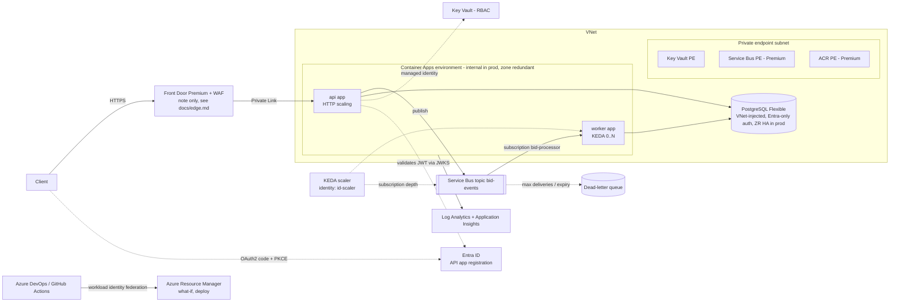

# AdFlow Platform on Azure (Bicep)

The Azure counterpart of [03-learning-platform-aws](../03-learning-platform-aws/README.md) (Terraform) and [07-gcp-event-pipeline](../07-gcp-event-pipeline/README.md) for the fictional "AdFlow" ad platform: a NestJS API plus a queue-driven worker, with messaging, a relational database, secrets and observability. All names, tenant and subscription ids are placeholders.

## What this is

- `main.bicep` (resource-group scope) composing **ten modules** in `modules/`: `network`, `identity`, `monitoring` (Log Analytics + Application Insights), `keyvault`, `servicebus`, `acr`, `postgres`, `containerapps-env`, `containerapp`, `aca-dns`, plus a generic `private-endpoint`.
- `params/dev.bicepparam` (cheap, public endpoints, Standard Service Bus, scale-to-zero worker) and `params/prod.bicepparam` (internal environment, zone redundancy, private endpoints, Premium Service Bus/ACR, HA PostgreSQL).
- `azure-pipelines.yml` (Azure DevOps: build -> test -> what-if -> deploy dev -> deploy prod behind environment approvals, workload identity federation) and `azure-deploy.yml.example` (GitHub Actions with OIDC).
- `docs/`: [Entra ID and OIDC notes](docs/entra-and-oidc.md), [edge note](docs/edge.md), [cross-cloud mapping](docs/cross-cloud-mapping.md), three ADRs in `docs/adr/`.

## Experience this project reflects

Designing and operating cloud platforms on Azure DevOps, AWS and GCP over 20+ years: container platforms with queue-driven autoscaling, event-driven backends, Infrastructure-as-Code with review gates (what-if/plan), pipelines with environment approvals and federated (secretless) credentials, identity and JWT validation for APIs, and cross-cloud trade-off analysis. This is a reference implementation of patterns, not a record of any specific production system.

## Architecture



Module wiring: `network` and `identity` and `monitoring` first -> `keyvault`, `servicebus`, `acr` (each grants roles to the identities it receives, optional private endpoint) -> `postgres` -> `containerapps-env` (+ `aca-dns` when internal) -> `containerapp` x2 (api, worker). Apps are gated by `deployApps` because the first image must exist in ACR (infrastructure first, push image, redeploy).

## Security

| Area | Decision |
|---|---|
| Identity | User-assigned managed identities; app identity gets only `Service Bus Data Sender/Receiver` (topic/subscription scope), `Key Vault Secrets User`, `AcrPull`, `Monitoring Metrics Publisher`. A separate scaler identity holds `Service Bus Data Owner` on the topic only ([ADR 0003](docs/adr/0003-identity-and-secrets.md)). |
| Secrets | None in templates or parameter files. SAS/local auth disabled on Service Bus, Log Analytics and Application Insights; ACR admin user off; PostgreSQL password auth disabled (Entra tokens). Optional Key Vault secret exposed to apps through a `keyVaultUrl` reference. |
| Network | Dedicated VNet; Container Apps in a delegated subnet (internal in prod); PostgreSQL VNet-injected with a private DNS zone, no public endpoint; Key Vault, Service Bus (Premium) and ACR (Premium) behind private endpoints with private DNS in prod. |
| API auth | Entra ID v2 tokens validated in NestJS against the tenant JWKS, issuer and audience pinned, role/scope guards ([docs](docs/entra-and-oidc.md)). |
| CI | Workload identity federation service connection (Azure DevOps) or GitHub OIDC; per-environment subjects; prod behind approvals. |
| Data protection | Key Vault purge protection and soft delete; PostgreSQL zone-redundant HA and geo-redundant backup in prod; Service Bus duplicate detection and a dead-letter queue. |
| Known gaps | No WAF/Front Door template (see [edge note](docs/edge.md)), no Defender for Cloud, no Azure Policy assignments, no CMK, no resource locks, no diagnostic settings for ACR/Container Apps beyond the environment's log destination, Log Analytics shared key still used by the environment. |

## Cost & trade-offs

Rough, order-of-magnitude monthly list prices (East US-like region, light traffic, from memory; verify with the Azure Pricing Calculator).

| Item | dev | prod | Notes |
|---|---|---|---|
| Container Apps | ~US$0-15 | ~US$150-500 | Consumption billing; worker scales to zero in dev. Zone redundancy needs a larger subnet footprint, not extra fee. |
| Service Bus | Standard ~US$10 | Premium ~US$670 per messaging unit | Biggest prod line item and the price of private endpoints. If a public endpoint with IP firewall and Entra-only auth is acceptable, Standard keeps it near US$10. |
| PostgreSQL Flexible | B1ms ~US$15-25 | D4ds_v5 zone-redundant HA ~US$500+ | HA doubles compute. Reserved capacity cuts 30-60 percent. |
| Key Vault / private endpoints | few US$ | ~US$7-8 per endpoint + data | Premium ACR (~US$50) required for its endpoint. |
| Log Analytics / App Insights | capped (1 GB/day) | per-GB ingestion (~US$2.3/GB) | Biggest hidden cost; use sampling and table plans. |
| Front Door Premium (not templated) | n/a | ~US$330 base + usage | Alternative: Application Gateway WAF_v2 ~US$250+. |

Trade-offs: Container Apps vs AKS ([ADR 0001](docs/adr/0001-container-apps-over-aks-and-app-service.md)); PostgreSQL vs Cosmos DB ([ADR 0002](docs/adr/0002-postgres-flexible-over-cosmos.md)); Premium Service Bus is expensive but is the only tier with private endpoints. The full AWS/GCP/Azure comparison is in [docs/cross-cloud-mapping.md](docs/cross-cloud-mapping.md).

## How to use

Prerequisites: Azure CLI with Bicep (`az bicep install`), a resource group, and rights to create resources and role assignments. Nothing here has been deployed.

```bash
az bicep build --file main.bicep --stdout >/dev/null
az bicep lint  --file main.bicep
# review
az deployment group what-if -g rg-adflow-dev -f main.bicep -p params/dev.bicepparam
# 1) infrastructure only (deployApps defaults to false)
az deployment group create -g rg-adflow-dev -f main.bicep -p params/dev.bicepparam
# 2) push an image (listen on 8080, GET /healthz), then deploy the apps
az acr build -r <acr-name> -t adflow-app:1 ./app
az deployment group create -g rg-adflow-dev -f main.bicep -p params/dev.bicepparam \
  -p deployApps=true apiImage=<acr>.azurecr.io/adflow-app:1 workerImage=<acr>.azurecr.io/adflow-app:1
```

Before first use: replace the placeholder `entraApiAudience` and PostgreSQL admin group in `params/*.bicepparam`, create the Entra app registration and the database principal ([docs](docs/entra-and-oidc.md)), create the Azure DevOps environments `adflow-dev`/`adflow-prod` with approvals, and service connections `sc-adflow-*-wif`. For prod, the registry is private: build from a pool with VNet connectivity (`buildPool` parameter).

## What was and wasn't validated

- **Not run: `bicep build`, `bicep lint`, `what-if`, deploy, pipeline YAML validation.** The Bicep CLI and Azure CLI were not installed, `brew` had no formula for bicep, and downloading the binary from GitHub was blocked by the sandbox allow-list. **No claim is made that these templates compile, lint clean or deploy.**
- What was done: a careful manual review plus a script check that every module call passes only parameters the module declares, supplies all required parameters, every `module.outputs.x` reference exists, parameter files cover all required `main.bicep` parameters, and brackets are balanced.
- Likely first-run fixes: API versions and the `identity` field of the KEDA custom scale rule may need adjusting to current schemas; `cidrSubnet` needs a recent Bicep; lint rule warnings (e.g. secure-parameter or no-hardcoded-env-urls); mixing a `.bicepparam` file with inline `-p key=value` overrides depends on Azure CLI version (if rejected, use a second param file or env-specific `readEnvironmentVariable`).
- Unverified assumptions: `Data Receiver` may be insufficient for KEDA depth reads (Data Owner on the topic used); Premium-only private endpoint behaviour and DNS zone names; prices above are from memory.
- Next steps: Front Door/WAF module, Azure Policy and Defender, CMK, locks, deployment stacks, Cosmos DB module if document workloads appear.
