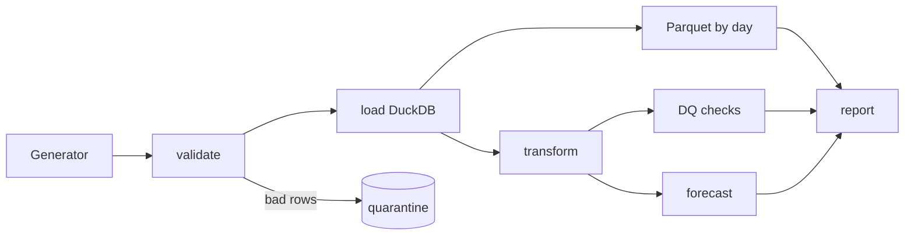

# AdFlow Python Data Pipeline

## What this is

A batch / micro-batch analytics pipeline for the (fictional) "AdFlow" ad platform, written in Python 3.11+. It takes impression and click
events (the contract in [`shared/contracts/ad-events.asyncapi.yaml`](../../shared/contracts/ad-events.asyncapi.yaml)),
validates them, loads them idempotently into DuckDB with day-partitioned Parquet, computes CTR, spend and pacing,
runs data-quality checks, fits a baseline CTR forecast and writes a Markdown and HTML report. All data is synthetic.

- **Generator**: seeded, deterministic; injects duplicates, late arrivals, malformed rows and (optionally) schema drift.
- **Validation**: Pydantic v2 with strict types; rejected rows go to a quarantine (dead-letter) JSONL file with a reason.
- **Load**: dedupe plus `INSERT ... ON CONFLICT DO UPDATE` by `eventId`; running twice yields identical tables.
- **Transform**: DuckDB SQL for aggregation, Polars for CTR / pacing / window finality; event-time watermark for late data.
- **Data quality**: small declarative DSL (`error: duplicate_rate <= 0.10`).
- **Forecast**: hour-of-day CTR profile vs a constant, scored on a one-day holdout (numpy only).
- **Orchestration**: plain Python `DAG` class and a Typer CLI; an Airflow-style example is included as documentation only.

## Experience this project reflects

23 years of building data-heavy backend systems, with Python used alongside Java and TypeScript: at-least-once feeds, idempotent
loads, late-data handling and treating data quality as an executable contract rather than a dashboard afterthought.

## Architecture



Full diagram and behaviors: [docs/architecture.md](docs/architecture.md). Decisions: [ADR 0001, batch vs streaming](docs/adr/0001-batch-vs-streaming.md).
Field rules and definitions: [docs/data-contract.md](docs/data-contract.md). Airflow mapping (not executed): [docs/airflow_example](docs/airflow_example/adflow_pipeline_dag.py).

### Design decisions and trade-offs

| Decision | Why | Trade-off |
|---|---|---|
| Recompute aggregates from the table | Late data and replays converge; no increment bugs | Full recompute cost grows with volume |
| Watermark labels windows, never drops data | Nothing silently lost; restatements are visible | Consumers must read `is_final` |
| Earliest `ingested_at` wins on conflict | Stable across replays | A genuinely corrected payload with the same id overwrites fields but keeps the first arrival time |
| `warn` vs `error` checks | Gate on what blocks consumers only | Needs thought per check |
| DuckDB file, single process | Zero infrastructure, fast, testable | One writer at a time |

## How to run

```bash
python3 -m venv .venv && . .venv/bin/activate   # Python >= 3.11
make install
make verify        # ruff, mypy --strict, pytest (coverage gate 85%)
make demo          # generate (seed 42), run, check -> out/
```

CLI: `adflow generate`, `adflow run --workdir out`, `adflow check --workdir out [--checks file.dq]`, `adflow report --workdir out`.
`run` and `check` exit 1 when an `error` check fails. Outputs land in `out/` (`warehouse.duckdb`, `parquet/`, `quarantine/`, `report/`).

Tests cover validators, load idempotency (including a Hypothesis order/repetition property), late-data restatement, DQ failure,
the DAG, the forecast and the CLI.

## Not verified

- Never run in CI from this repository yet; local runs used Python 3.14, the workflow targets 3.12.
- The Airflow example was never executed.
- The forecast is a baseline on synthetic data; it makes no claim about real ad performance.
- Performance at large volume was not measured.
