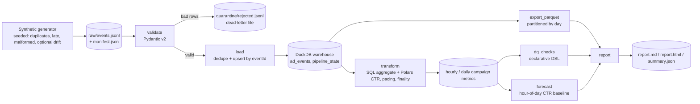

# Architecture

The seven tasks are registered in `adflow_pipeline.pipeline.build_dag()` through the small `DAG` class in `dag.py`
(named tasks, explicit dependencies, deterministic topological order, failed task skips its downstream).
[`airflow_example/adflow_pipeline_dag.py`](airflow_example/adflow_pipeline_dag.py) shows the same graph as an Airflow DAG;
it is documentation only and is never executed or tested here.

## Key behaviors

| Concern | Mechanism |
|---|---|
| Idempotency | In-batch dedupe (canonical choice independent of order), then `INSERT ... ON CONFLICT (event_id) DO UPDATE` with `ingested_at = LEAST(old, new)`. Aggregates are rebuilt from the table (replace, never increment). |
| Late data | Event-time watermark = `max(occurred_at) - allowed_lateness`, monotonic, stored in `pipeline_state`. Windows ending before it are `is_final`. New events behind the previous watermark are counted as `restated` and reported; their windows are recomputed. |
| Bad data | Every non-blank input line ends up valid or quarantined with a reason; none is dropped silently. |
| Quality gate | `error` checks fail the run (exit code 1) after the report is still written; `warn` checks are reported only. |
| Storage | DuckDB file is the source of truth; Parquet lake (`parquet/ad_events/day=YYYY-MM-DD/`) is rewritten deterministically from it. |

## Limits

Single process, single writer (DuckDB file lock), in-memory validation of one batch file. Fine for millions of rows on a laptop;
beyond that, stream the file in chunks or move the same SQL to a warehouse.
