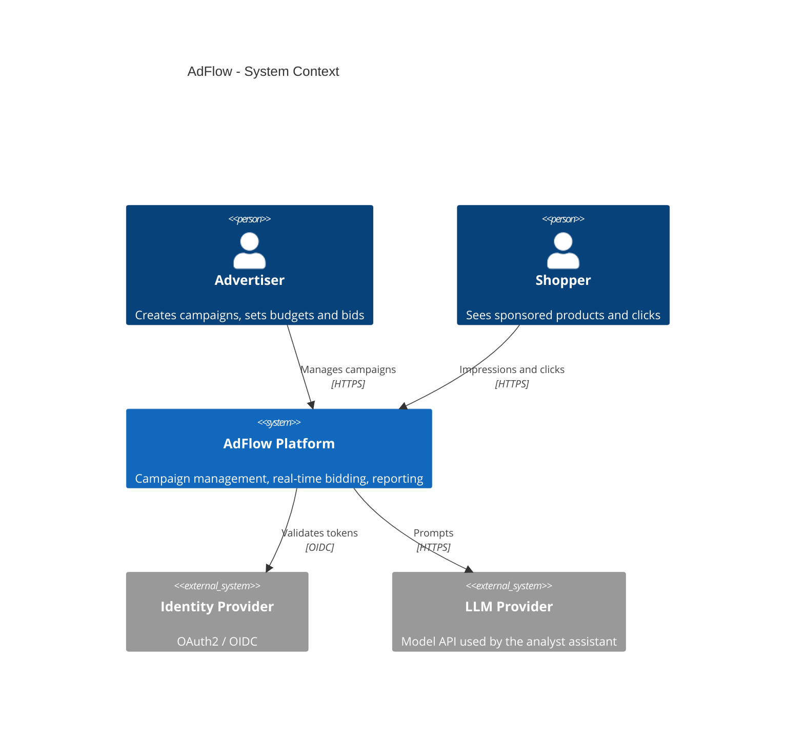
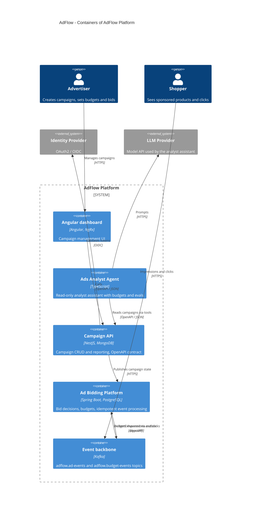

# AdFlow

> Generated by `archkit c4 render`. Do not edit by hand.

## System context

## Containers: AdFlow Platform

## Elements

| Element | Kind | Technology | Description |
|---|---|---|---|
| Advertiser | person |  | Creates campaigns, sets budgets and bids |
| Shopper | person |  | Sees sponsored products and clicks |
| AdFlow Platform | system |  | Campaign management, real-time bidding, reporting |
| Identity Provider | system (external) |  | OAuth2 / OIDC |
| LLM Provider | system (external) |  | Model API used by the analyst assistant |
| Angular dashboard | container | Angular, NgRx | Campaign management UI |
| Ads Analyst Agent | container | TypeScript | Read-only analyst assistant with budgets and evals |
| Campaign API | container | NestJS, MongoDB | Campaign CRUD and reporting, OpenAPI contract |
| Ad Bidding Platform | container | Spring Boot, PostgreSQL | Bid decisions, budgets, idempotent event processing |
| Event backbone | container | Kafka | adflow.ad-events and adflow.budget-events topics |

## Relations

| From | To | Description | Technology |
|---|---|---|---|
| Advertiser | Angular dashboard | Manages campaigns | HTTPS |
| Shopper | Event backbone | Impressions and clicks | HTTPS |
| Angular dashboard | Campaign API | Calls | OpenAPI / JSON |
| Ads Analyst Agent | Campaign API | Reads campaigns via tools | OpenAPI / JSON |
| Campaign API | Ad Bidding Platform | Publishes campaign state | HTTPS |
| Event backbone | Ad Bidding Platform | Delivers impressions and clicks | AsyncAPI |
| Ad Bidding Platform | Event backbone | BudgetExhausted via outbox | AsyncAPI |
| Campaign API | Identity Provider | Validates tokens | OIDC |
| Ads Analyst Agent | LLM Provider | Prompts | HTTPS |
