# AdFlow API Gateway with ASP.NET Core and YARP

## What this is

A step-by-step, tutorial-style build of a **self-hosted API gateway** in C# on .NET 9 with [YARP](https://microsoft.github.io/reverse-proxy/) (Yet Another Reverse Proxy), protecting two internal REST APIs of a fictional ad platform, "AdFlow":

- `Campaigns.Api` (two instances, load balanced) and `Reports.Api`: small minimal APIs that are **only reachable inside the compose network**. The gateway is the single entry point.
- `Gateway`: authentication, authorization, rate limiting, abuse bans, request validation, TLS and secure headers, IP filtering, timeouts, health checks, structured logging and audit, load balancing, retry and circuit breaker, metrics, versioning, API keys with quotas, caching, admin endpoints and a (clearly labelled) WAF-lite inspection point.
- `Gateway.Tests`: xUnit integration tests through `WebApplicationFactory`, with in-process fake downstream services on real loopback ports.

Everything is synthetic and there are no secrets in the repo: the dev JWT signing key is generated at startup, the demo API key `orbit.demo-key-change-me` and the certificate password `dev-only-change-me` are documented placeholders.

Read it as a guided walkthrough: the [step-by-step guide](#step-by-step-guide) below has one page per step in [`docs/steps/`](docs/steps/), each with why it matters, the code and config added (linked), how to try it with `curl`, and what it mitigates.

## Experience this project reflects

Condensed from 20+ years of backend and platform work:

- **Designing and securing REST/API layers**: a single, explicit entry point; deny by default; every route declares its policy, limits and timeouts in reviewable configuration.
- **OAuth2 / JWT**: OIDC-style validation (issuer, audience, signature, lifetime, bounded clock skew, algorithm allowlist), scope- and role-based authorization, and machine clients with hashed API keys and quotas.
- **Rate limiting and abuse control**: token bucket, sliding window and concurrency limiters, then adaptive bans for what static limits miss.
- **Observability**: structured logs, W3C trace context, a separate security audit trail, OpenTelemetry metrics and alert rules.
- **Load balancing and resilience** across JEE, .NET and cloud stacks: health checks, power-of-two-choices balancing, timeouts, retries only where safe, circuit breaking, and honest notes on where each tool's responsibility ends.

## Architecture

```mermaid
flowchart LR
    C([Client / partner app]) -->|HTTPS| T
    subgraph GW["Gateway (ASP.NET Core + YARP)"]
        direction TB
        T[TLS, HSTS, forwarded headers<br/>secure headers, correlation id]
        T --> F[IP deny list / admin allowlist<br/>temporary bans]
        F --> V[Request validation<br/>method, path, size, headers]
        V --> W[WAF-lite signatures<br/>teaching example]
        W --> A[Authentication<br/>JWT or API key]
        A --> R[Rate limits<br/>IP window, client bucket, concurrency]
        R --> Z[Authorization<br/>role + scope per route]
        Z --> Q[API key quota]
        Q --> K[Output cache<br/>per identity]
        K --> I[Strip spoofable headers<br/>inject trusted identity]
        I --> Y{{YARP<br/>routes, LB, health checks<br/>retry + circuit breaker}}
    end
    EDGE[[Edge WAF / DDoS / CDN<br/>not provided by this project]] -.-> C
    Y --> S1[Campaigns.Api #1]
    Y --> S2[Campaigns.Api #2]
    Y --> S3[Reports.Api]
    ADM[Operator] -->|allowlisted IP + admin role| AD[/admin: bans, stats, audit, reload, metrics/]
    AD --- GW
```



Internal services have no published ports and live on an `internal: true` Docker network. A request is rejected at the earliest, cheapest layer that can decide. The pipeline order is in [`Program.cs`](src/Gateway/Program.cs), annotated with step numbers.

## Feature priority table

Priority reflects the risk reduced per unit of effort; steps are built in this order.

| # | Step | Feature | Priority | Toggle (`Gateway:*`) |
|--:|---|---|---|---|
| 1 | [Reverse proxy](docs/steps/step-01-reverse-proxy.md) | YARP routes/clusters from config; internal APIs not published | Must | `ReverseProxy` |
| 2 | [JWT authentication](docs/steps/step-02-jwt-authentication.md) | issuer, audience, signature, lifetime, skew; dev token endpoint | Must | `Auth` |
| 3 | [Authorization](docs/steps/step-03-authorization-policies.md) | role + scope policies per route | Must | route `AuthorizationPolicy` |
| 4 | [Rate limiting](docs/steps/step-04-rate-limiting.md) | token bucket, sliding window, concurrency, 429 + Retry-After | Must | `RateLimit` |
| 5 | [Abuse protection](docs/steps/step-05-abuse-protection.md) | N failures leads to a temporary IP ban; Redis-shaped interface | Should | `Abuse` |
| 6 | [Request validation](docs/steps/step-06-request-validation.md) | methods, size, headers, path traversal, spoof stripping, identity injection | Must | `Validation` |
| 7 | [TLS and secure headers](docs/steps/step-07-tls-and-secure-headers.md) | HTTPS, HSTS, CSP/nosniff, trusted forwarded headers | Must | `Https`, `Forwarded` |
| 8 | [IP filtering](docs/steps/step-08-ip-filtering.md) | CIDR deny list; admin allowlist | Should | `IpFilter` |
| 9 | [Timeouts](docs/steps/step-09-timeouts.md) | activity, per-route, named policies | Must | `Timeouts` |
| 10 | [Health checks](docs/steps/step-10-health-checks.md) | active + passive | Must | cluster `HealthCheck` |
| 11 | [Logging and correlation](docs/steps/step-11-logging-and-correlation.md) | JSON logs, W3C `traceparent` | Must | `Logging` |
| 12 | [Security audit log](docs/steps/step-12-security-audit-log.md) | rejected access and admin changes, separate sink | Should | `Audit` |
| 13 | [Load balancing](docs/steps/step-13-load-balancing.md) | PowerOfTwoChoices over two instances; affinity note | Should | cluster `LoadBalancingPolicy` |
| 14 | [Retry and circuit breaker](docs/steps/step-14-retry-and-circuit-breaker.md) | Polly on idempotent GETs, honest YARP integration | Should | `Resilience` |
| 15 | [Metrics](docs/steps/step-15-metrics.md) | OpenTelemetry + Prometheus (admin only), alert rules | Should | OpenTelemetry env vars |
| 16 | [API versioning](docs/steps/step-16-api-versioning.md) | `/api/v1`, `/api/v2` with path transforms, sunset headers | Could | route transforms |
| 17 | [API keys and quotas](docs/steps/step-17-api-keys-and-quotas.md) | hashed keys, scopes, daily quota | Should | `ApiKeys` |
| 18 | [Response caching](docs/steps/step-18-response-caching.md) | output cache for safe GETs, vary by identity | Could | `Cache` |
| 19 | [Admin endpoints](docs/steps/step-19-admin-endpoints.md) | bans, stats, audit, reload; allowlisted + admin + audited | Should | `IpFilter:AdminAllow` |
| 20 | [WAF integration](docs/steps/step-20-waf-integration.md) | explicit non-WAF; signature middleware; ModSecurity/CRS/Coraza docs | Could | `Waf:Mode` |

## Step-by-step guide

Prerequisites: .NET 9 SDK, `curl`, `jq`; Docker for the compose path. Setup shared by every step:

```bash
cd track-architect/11-dotnet-api-gateway-yarp
make run-local                       # gateway :8080, campaigns :5101/:5102, reports :5201 (no Docker)
BASE=http://127.0.0.1:8080
tok() { curl -s -XPOST $BASE/dev/token -H 'content-type: application/json' -d "{\"user\":\"$1\"}" | jq -r .access_token; }
TOKEN=$(tok alice); BOB=$(tok bob); ROOT=$(tok root)
```

Demo users: `alice` (role `campaign-manager`, scopes `campaigns.read campaigns.write`), `bob` (`analyst`, `campaigns.read reports.read`), `root` (`admin`).

| Step | What you build | Key code |
|---|---|---|
| [1](docs/steps/step-01-reverse-proxy.md) | Routes and clusters in config; services not published | [`appsettings.json`](src/Gateway/appsettings.json), [`docker-compose.yml`](docker-compose.yml) |
| [2](docs/steps/step-02-jwt-authentication.md) | JWT validation and a dev token endpoint | [`ConfigureJwtBearer.cs`](src/Gateway/Security/ConfigureJwtBearer.cs) |
| [3](docs/steps/step-03-authorization-policies.md) | Role and scope policies per route | [`Program.cs`](src/Gateway/Program.cs) |
| [4](docs/steps/step-04-rate-limiting.md) | Three limiters and `Retry-After` | [`RateLimiting.cs`](src/Gateway/RateLimiting/RateLimiting.cs) |
| [5](docs/steps/step-05-abuse-protection.md) | Adaptive IP bans | [`AbuseTracker.cs`](src/Gateway/Abuse/AbuseTracker.cs) |
| [6](docs/steps/step-06-request-validation.md) | Validation, header stripping, identity injection | [`RequestValidationMiddleware.cs`](src/Gateway/Middleware/RequestValidationMiddleware.cs) |
| [7](docs/steps/step-07-tls-and-secure-headers.md) | TLS, HSTS, secure headers, trusted proxies | [`SecurityHeadersMiddleware.cs`](src/Gateway/Middleware/SecurityHeadersMiddleware.cs) |
| [8](docs/steps/step-08-ip-filtering.md) | CIDR allow/deny | [`IpPolicy.cs`](src/Gateway/Infrastructure/IpPolicy.cs) |
| [9](docs/steps/step-09-timeouts.md) | Timeouts at three levels | [`appsettings.json`](src/Gateway/appsettings.json) |
| [10](docs/steps/step-10-health-checks.md) | Active and passive health | [`appsettings.json`](src/Gateway/appsettings.json) |
| [11](docs/steps/step-11-logging-and-correlation.md) | JSON logs and trace context | [`CorrelationMiddleware.cs`](src/Gateway/Middleware/CorrelationMiddleware.cs) |
| [12](docs/steps/step-12-security-audit-log.md) | Audit trail | [`AuditLog.cs`](src/Gateway/Audit/AuditLog.cs) |
| [13](docs/steps/step-13-load-balancing.md) | Load balancing | [`appsettings.json`](src/Gateway/appsettings.json) |
| [14](docs/steps/step-14-retry-and-circuit-breaker.md) | Retry and breaker via a custom forwarder client | [`IdempotentResilienceHandler.cs`](src/Gateway/Proxy/IdempotentResilienceHandler.cs) |
| [15](docs/steps/step-15-metrics.md) | OpenTelemetry and Prometheus | [`Program.cs`](src/Gateway/Program.cs), [`alerts.yml`](ops/prometheus/alerts.yml) |
| [16](docs/steps/step-16-api-versioning.md) | v1/v2 transforms | [`appsettings.json`](src/Gateway/appsettings.json) |
| [17](docs/steps/step-17-api-keys-and-quotas.md) | API keys and daily quotas | [`ApiKeyAuthentication.cs`](src/Gateway/Security/ApiKeyAuthentication.cs) |
| [18](docs/steps/step-18-response-caching.md) | Identity-aware output cache | [`SafeGetCachePolicy.cs`](src/Gateway/Caching/SafeGetCachePolicy.cs) |
| [19](docs/steps/step-19-admin-endpoints.md) | Admin API | [`AdminEndpoints.cs`](src/Gateway/Endpoints/AdminEndpoints.cs) |
| [20](docs/steps/step-20-waf-integration.md) | WAF-lite and real WAF integration | [`WafMiddleware.cs`](src/Gateway/Middleware/WafMiddleware.cs), [`waf-integration.md`](docs/waf-integration.md) |

**Checkpoints without git history.** The repository holds the final state. Each step page lists the files it introduced and the `Gateway:*` switches for its feature; each test class carries `[Trait("Step", "NN")]`, so `make test-step STEP=04` runs exactly one step's tests. To replay the tutorial, start a new solution, add the step's files in order, and use that step's tests as the checkpoint.

## Threat model

| Threat | Control | Where in code | Test |
|---|---|---|---|
| Anonymous or forged access | JWT validation, deny-by-default fallback policy | [`ConfigureJwtBearer.cs`](src/Gateway/Security/ConfigureJwtBearer.cs), [`Program.cs`](src/Gateway/Program.cs) | `AuthenticationTests` |
| Token for another API/issuer, expired token, `alg` confusion | Audience, issuer, lifetime, algorithm allowlist | `ConfigureJwtBearer` | `Expired_token_gets_401`, `Token_for_another_audience_gets_401` |
| Privilege escalation | Role + scope policies per route | `Program.cs` (policies), `appsettings.json` | `AuthorizationTests` |
| Brute force, scraping, client loops | Sliding window, token bucket, concurrency limiter | [`RateLimiting.cs`](src/Gateway/RateLimiting/RateLimiting.cs) | `RateLimitingTests` |
| Persistent attacker that stays under static limits | Adaptive temporary bans | [`AbuseTracker.cs`](src/Gateway/Abuse/AbuseTracker.cs) | `AbuseProtectionTests` |
| Path traversal, double encoding, NUL bytes | Path normalization checks | [`PathSafety`](src/Gateway/Middleware/RequestValidationMiddleware.cs) | `Suspicious_paths_are_rejected_with_400` |
| Oversized bodies, header floods, wrong content types | Global and per-route limits | `RequestValidationMiddleware`, [`RouteLimitsMiddleware.cs`](src/Gateway/Middleware/RouteLimitsMiddleware.cs) | `Oversized_body_gets_413...`, `Wrong_content_type_gets_415` |
| Identity header spoofing (`X-User-*`, `X-Forwarded-*`) | Strip then inject trusted identity | [`IdentityHeadersMiddleware.cs`](src/Gateway/Middleware/IdentityHeadersMiddleware.cs) | `Spoofed_identity_and_forwarding_headers_are_stripped...` |
| Client-IP spoofing via `X-Forwarded-For` | Forwarded headers only from known proxies | `Program.cs` (`ForwardedHeadersOptions`) | `Forwarded_headers_from_untrusted_peers_are_ignored` |
| Management surface exposed | Admin IP allowlist + admin role + audit | [`IpFilterMiddleware.cs`](src/Gateway/Middleware/IpFilterMiddleware.cs), [`AdminEndpoints.cs`](src/Gateway/Endpoints/AdminEndpoints.cs) | `Admin_routes_are_blocked_for_non_allowlisted_ips...` |
| Known-bad networks | CIDR deny list | [`IpPolicy.cs`](src/Gateway/Infrastructure/IpPolicy.cs) | `Denied_cidr_range_gets_403` |
| Sniffing, framing, fingerprinting | TLS, HSTS, secure headers, banner removal | [`SecurityHeadersMiddleware.cs`](src/Gateway/Middleware/SecurityHeadersMiddleware.cs) | `Responses_carry_secure_headers...` |
| Slow upstream exhausting the gateway | Timeouts at three levels | `appsettings.json`, `Program.cs` | `Slow_downstream_yields_504...` |
| One replica failing becomes an outage | Health checks, load balancing | `appsettings.json` | `HealthCheckTests`, `LoadBalancingTests` |
| Cascading failures, retry storms | Breaker per destination, retries for idempotent GETs only | [`IdempotentResilienceHandler.cs`](src/Gateway/Proxy/IdempotentResilienceHandler.cs) | `ResilienceHandlerTests` |
| Partner key theft or runaway integration | Hashed keys, scopes, daily quota, key not forwarded | [`ApiKeyAuthentication.cs`](src/Gateway/Security/ApiKeyAuthentication.cs) | `ApiKeyTests` |
| Cross-user cache leak | Cache key varies by identity | [`SafeGetCachePolicy.cs`](src/Gateway/Caching/SafeGetCachePolicy.cs) | `Safe_gets_are_cached_per_user...` |
| Obvious injection probes | Signature inspection (teaching example) | [`WafMiddleware.cs`](src/Gateway/Middleware/WafMiddleware.cs) | `WafTests` |
| Repudiation, undetected probing | Audit trail, correlation ids | [`AuditLog.cs`](src/Gateway/Audit/AuditLog.cs), `CorrelationMiddleware` | `AuditTests`, `CorrelationTests` |
| Direct access to internal APIs | No published ports, internal network, services refuse calls without gateway identity | `docker-compose.yml` | CI step "Internal services are not reachable from the host" |

## How to run

Without Docker (needs the .NET 9 SDK):

```bash
make run-local     # builds, starts 4 processes; logs in ./logs
make smoke         # black-box curl checks (needs jq)
make stop-local
```

With Docker Compose (gateway on 8080/8443, services unpublished):

```bash
make up            # creates a dev certificate, builds and starts
make smoke
make abuse         # watch an IP get banned
make down
```

Admin endpoints answer only to allowlisted networks (`127.0.0.1`, `::1`, `10.0.0.0/8` by default; compose adds Docker's bridge range for the demo). A load/abuse sketch for k6 is in [`scripts/loadtest.k6.js`](scripts/loadtest.k6.js); it is not run in CI.

## How to test

```bash
make test                    # restore, build with warnings as errors, run all tests
make test-step STEP=04       # one step's tests
```

The tests start the real gateway in-process (`WebApplicationFactory`) against fake downstream services listening on loopback ports, choose the caller's IP per test, and cover 401, 403, 429 + `Retry-After`, IP deny, 413, 415, spoofed headers, path traversal, API-key quota, active and passive failover, circuit breaking, correlation, WAF-lite, admin allowlisting and more. CI ([`.github/workflows/dotnet-api-gateway-yarp.yml`](../../.github/workflows/dotnet-api-gateway-yarp.yml)) builds, runs the tests, then brings up the compose stack and runs `scripts/smoke.sh`.

## Honest limits

- **A gateway is not a WAF.** YARP routes; it does not understand attacks. The signature middleware is a teaching example that is trivially evaded (encodings, fragmentation, JSON escapes) and will false-positive on some legitimate data. Put ModSecurity + OWASP CRS, Coraza or a cloud WAF in front ([`docs/waf-integration.md`](docs/waf-integration.md)).
- **No DDoS defence.** Volumetric L3/L4 floods and large L7 floods are absorbed at the edge (CDN/anycast, cloud DDoS protection, upstream scrubbing), not by a process that shares a link and CPU with the traffic it is filtering. Rate limits and bans here protect the application layer and the services behind it, per instance.
- **Per-instance state.** Rate limiter partitions, bans, failure counters and quotas are in memory. With several gateway replicas they are per replica (limits effectively multiply). `IAbuseStore` and `IQuotaStore` are the seams for Redis; they are not implemented here. Counters are lost on restart.
- **No bot or reputation intelligence**, geo-blocking data, managed rule updates, or response/DLP inspection.
- **Internal trust is by network and headers.** Services trust `X-User-*` only because nothing else can reach them. A compromised neighbour can forge them. Use mTLS or a service mesh and have services validate a gateway-signed assertion for stronger isolation. The gateway-to-service hop is plain HTTP in this demo.
- **Dev conveniences are unsafe for production**: the token endpoint, the generated symmetric key, the self-signed certificate, the demo API key, and the Docker bridge range in the admin allowlist.
- **Retries and the breaker act per destination, not across the cluster**: a retry returns to the same instance; failing over to the other one relies on health checks and the load balancer.
- Rate limiter instances take the limits that were current when a partition was first created; reloading configuration changes limits for new partitions only.

## Not verified

> **Update — verified in GitHub Actions** (workflow `dotnet-api-gateway-yarp`): the solution builds with warnings-as-errors, the xUnit integration tests pass, and the Docker Compose smoke test passes on a runner with the .NET SDK. Getting there needed one fix: the in-memory `TestServer` refuses a decoded NUL byte before any middleware runs, so that case is asserted as "nothing is forwarded" instead of "returns 400". The paragraph below describes the original authoring session, which had no .NET SDK. Items that CI does not exercise are still unverified: the ModSecurity/CRS override, the Prometheus profile and alert rules, the k6 script, and behaviour behind a real TLS-terminating proxy or WAF.

This project was written and reviewed, but **nothing was compiled, run or tested in the authoring environment**: no .NET SDK was available (`brew install dotnet` failed inside the sandbox, `sandbox_apply: Operation not permitted`, and the official install script's host was not reachable), so there was no `dotnet build`, no `dotnet test`, no `docker compose`, and no `curl` run against a live gateway. The CI workflow will be the first real compile and test run; expect to fix a few compile errors or test timing assumptions on that first run. In particular unverified are:

- Exact NuGet package versions and some API details (YARP `RouteModel` metadata access, `IForwarderHttpClientFactory` members, OpenTelemetry Prometheus exporter options, YARP meter name `Yarp.ReverseProxy` and the Prometheus metric names used in the alert rules, the passive health-policy metadata key used in a test).
- The ordering assumptions between the rate limiter, output cache and YARP endpoint metadata, and the test-only `IStartupFilter` that sets the caller IP.
- The Docker images, the compose files, the smoke script and the ModSecurity/CRS override ([`deploy/waf/docker-compose.waf.yml`](deploy/waf/docker-compose.waf.yml)); the Prometheus profile and alert rules; the k6 script.
- Behaviour behind a real TLS-terminating proxy or WAF with `KnownNetworks` configured.
