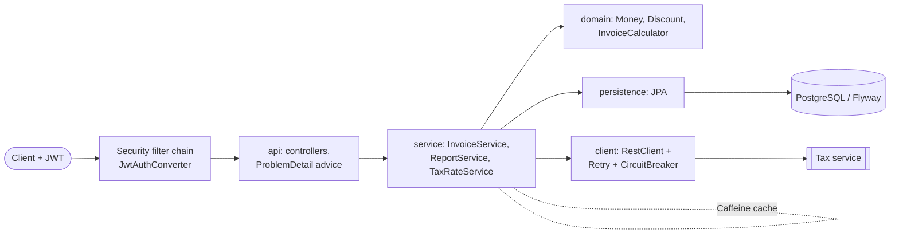

# AdFlow Advertiser Billing & Reporting Service

## What this is

A classic **layered** Spring Boot 3.3 / Java 21 REST service for the (fictional) "AdFlow" ad platform, built test-first
to show disciplined TDD and testing craft rather than architecture novelty (for hexagonal + Kafka see
[`track-architect/02-ad-bidding-platform`](../../track-architect/02-ad-bidding-platform/README.md)).

- `POST /v1/invoices`: builds an invoice from campaign lines, applies a percent or fixed discount, fetches the tax rate
  from an external tax service, stores it. `GET /v1/invoices/{id}`, `POST /v1/invoices/{id}/void` (role ADMIN).
- `POST /v1/campaigns/{id}/usage` and `GET /v1/campaigns/{id}/report`: spend/CTR reporting, the report shape comes from
  [`shared/contracts/campaign-api.openapi.yaml`](../../shared/contracts/campaign-api.openapi.yaml).
- OAuth2 resource server (JWT; scopes `billing:read` / `billing:write`, roles from the `roles` claim), RFC 7807 errors,
  springdoc at `/swagger-ui.html`, Actuator health/metrics, JSON logs with a correlation id (`--spring.profiles.active=json`).

All data is synthetic. Money is **integer cents** everywhere; tax and discounts are basis points with half-up rounding in
`long` arithmetic. Amounts that would overflow fail loudly (`Math.*Exact`) and become a 400.

## Experience this project reflects

23 years of Java, Spring Boot since its early releases. The point here is the habits that keep a service changeable:
tests written first, a fast test pyramid, mutation testing to check that the tests actually assert something,
architecture rules enforced by the build, and resilience around the one external dependency.

## Architecture



Packages: `api -> service -> {domain, persistence, client}`; `domain` depends on nothing (ArchUnit-enforced).

## Key design decisions & trade-offs

| Decision | Why | Trade-off |
|---|---|---|
| Money as `long` cents, rates as basis points | No float drift; exact property tests | Single currency (USD); sub-cent pricing not modelled |
| Sealed `Discount` + `switch` | Compiler checks every discount type is handled | New type touches the switch (intended) |
| Resilience4j used programmatically, Retry(CircuitBreaker(call)) | Each attempt counts toward the breaker; easy to unit test with WireMock | No annotation magic, a bit more wiring |
| Timeouts via HTTP client, not TimeLimiter | Blocking call; avoids an extra thread pool | Timeout covers connect/read, not total time |
| Tax rate cached 10 min (Caffeine) | Rates change rarely; cuts latency and outage exposure | Stale rate for up to 10 min; cache is per instance |
| Invoice stores the rate used | Reproducible invoices after rate changes | Extra column |
| H2 (PostgreSQL mode) for fast tests + Testcontainers Postgres IT | Seconds-fast feedback; real DB check where Docker exists | H2 is not Postgres, hence the container IT |
| Layered, not hexagonal | Simple CRUD-plus-calculation service; the layers are still enforced | JPA entities are visible to the service layer |
| Service read model (`InvoiceView`) is returned by the API directly | Less mapping code | API shape coupled to the view record |

## How to run

```bash
make up    # PostgreSQL via docker compose
make run   # needs a JWKS endpoint (JWT_JWK_SET_URI) and a tax service (TAX_SERVICE_URL)
```

Tokens are validated against `JWT_JWK_SET_URI` (default `http://localhost:9000/.well-known/jwks.json`, fetched lazily).
The tax service is expected to expose `GET /v1/tax-rates/{region}` returning `{"region":"US-CA","rateBps":825}`.

## How to test

```bash
make test       # mvn -B verify: all tests, Spotless check, JaCoCo gate
make mutation   # mvn -B verify -Pmutation: PIT on com.adflow.billing.domain, threshold 90%
make format     # spotless:apply (google-java-format)
```

| Layer | Tests |
|---|---|
| Unit | `domain/*` (JUnit 5, AssertJ), `ServicesTest` (Mockito) |
| Property-based | `InvoicePropertiesTest` (jqwik): five invariants of the calculator |
| Slice | `InvoiceControllerTest` (`@WebMvcTest`), `InvoiceRepositoryTest` (`@DataJpaTest` on Flyway schema) |
| Client | `HttpTaxRateClientTest` (WireMock: retry, timeout, 404, circuit open) |
| Integration | `BillingApiIT`, `SecurityIT` (`@SpringBootTest`, signed RS256 JWTs from a local key pair, no network) |
| Container | `PostgresContainerIT` (Testcontainers, `disabledWithoutDocker = true`) |
| Architecture | `LayeringTest` (ArchUnit) |
| Contract | `CampaignApiContractTest` |

**Contract testing scope.** The shared OpenAPI describes the whole Campaign API, owned by the NestJS provider. This
service only implements `GET /v1/campaigns/{id}/report` and the `Problem` error schema, so the contract test reads the
YAML and checks that real responses contain every `required` property with the declared JSON type. Campaign CRUD
endpoints are deliberately not tested here, and invoices are not in the shared contract (they are this service's own
API, documented by springdoc).

How the work was done is in [`docs/tdd-log.md`](docs/tdd-log.md).

### Results of the last run (Java 21, Maven 3.9)

- `mvn verify`: 70 tests, 0 failures, 1 skipped (`PostgresContainerIT`, Docker unavailable on the authoring machine).
- JaCoCo: 96.8% line, 90.5% branch (gate: 85% line overall, 90% branch on the `domain` package).
- PIT on `domain`: 31 mutations, 30 killed = **97%** (threshold 90%). The survivor is `Money.min` using `<=` instead of
  `<`, an equivalent mutant (equal values give the same result).

## What I would do next in production

- Run `PostgresContainerIT` in CI (Docker available there) and add a Pact or schema-validator based contract check
  once the report endpoint is covered by a shared provider spec.
- Real identity provider (issuer validation, audience claim, key rotation tests); the JWT tests here use a local key.
- Pagination and listing of invoices by advertiser (the repository method exists, no endpoint yet), plus idempotency
  keys on `POST /v1/invoices` to make client retries safe.
- Multi-currency money type, tax by line item/jurisdiction, and invoice numbering.
- Distributed cache or per-region warm-up for tax rates; Resilience4j metrics exported to Micrometer; bulkhead.
- Run PIT incrementally on the changed classes in pull requests and extend it to `service`/`api`.
- Optimistic locking on invoices (`@Version`) for concurrent void requests.
- Load tests and Kubernetes manifests with readiness probes (Actuator probes are enabled).
