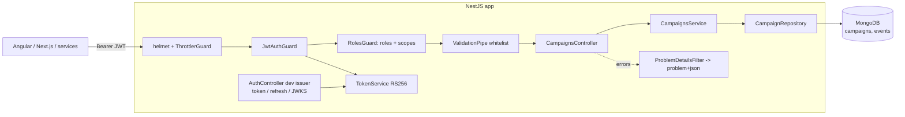

# 02 - NestJS Secure API (AdFlow Campaign API)

## What this is

A production-shaped REST API for **AdFlow**, a *fictional* ad platform (all data is synthetic, no real
secrets). It manages advertising campaigns and exposes an aggregated performance report.

- NestJS 11 + TypeScript (strict), layered as controller -> service -> repository
- OAuth2/OIDC-style JWT bearer authentication (RS256), access + refresh tokens, RBAC (`ADMIN`, `ADVERTISER`) and scopes
- MongoDB via Mongoose: schemas, indexes and an aggregation pipeline
- RFC 7807 `application/problem+json` for every error
- Swagger at `/docs`, helmet, rate limiting, health endpoint
- Implements the shared contract `shared/contracts/campaign-api.openapi.yaml`, enforced by a contract test

## Experience this project reflects

This project condenses patterns from two decades of building backend services, in generic form:

- **NestJS/Express REST APIs next to Spring Boot services.** The same concerns show up in both
  ecosystems: layered design, DTO validation, centralized error handling, dependency injection. The
  Nest controller/service/repository split maps one-to-one to Spring's `@RestController` / `@Service` /
  repository pattern, and `ValidationPipe` + exception filter mirror Bean Validation + `@ControllerAdvice`.
- **OAuth2 / OpenID Connect with JWT access and refresh tokens and RBAC.** Short-lived access tokens,
  rotating single-use refresh tokens, role checks plus fine-grained scopes, and strict verification
  (algorithm allow-list, issuer, audience, expiry, token type).
- **Service-to-service security.** Services trust tokens, not network location: the verifier needs only
  public key material, so any caller (a front end, a batch job, another service with a client-credentials
  token) goes through the same guard chain. Scopes model machine clients; roles model human users.
- **MongoDB/Mongoose schema, index and aggregation design.** Indexes are designed from access patterns
  (equality field first, then the sort key), money is stored as integer cents, and reporting is pushed
  into the database with `$match` + `$group` rather than loading documents into application memory.
- **OpenAPI contracts consumed by Angular and Next.js front ends.** The contract is the source of truth
  shared by provider and consumers. Here the spec is generated from decorators and a test fails the
  build if the running app drifts from the shared file, so generated clients stay trustworthy.
- **Cognito-style token validation.** Claims handling follows what managed IdPs emit: `scope` as a
  space-separated string, groups from either `roles` or `cognito:groups`, `token_use` to separate access
  from refresh tokens, and a JWKS document for key distribution and rotation.

## Architecture



```
src/
  auth/        TokenService (issue/verify), JwtAuthGuard, RolesGuard, decorators, dev issuer controller
  campaigns/   controller, service, repository, DTOs, Mongoose schemas (campaigns, events)
  common/      ProblemDetailsFilter
  config/      typed env configuration
  health/      health controller
  app.setup.ts pipeline shared by main.ts and e2e tests (pipes, filter, helmet, Swagger)
```

## Security model

| Concern | Implementation |
| --- | --- |
| Authentication | `JwtAuthGuard` (global, deny by default; `@Public()` opts out). RS256 only, verifies signature, `iss`, `aud`, `exp`, and `token_use=access`. `alg=none` and refresh tokens used as access tokens are rejected. |
| Authorization | `RolesGuard` (global) reads `@Roles()` (any-of) and `@Scopes()` (all-of). GET: any authenticated user with `campaigns:read`. POST/PATCH: `ADVERTISER` or `ADMIN`. DELETE: `ADMIN`. |
| Refresh | `POST /auth/refresh` rotates the pair; each refresh token is single use and replay returns 401. |
| Input | `ValidationPipe` with `whitelist` + `forbidNonWhitelisted` + `transform`; unknown fields are a 400, so clients cannot mass-assign `ownerId` or `status` where not allowed. |
| Errors | `ProblemDetailsFilter` returns `application/problem+json`; unexpected errors never leak stack traces. |
| Transport/abuse | `helmet` headers; global rate limit (default 100/min/IP) with stricter limits on token endpoints. |
| Dev issuer | `POST /auth/token`, `POST /auth/refresh`, `GET /.well-known/jwks.json`, only when `AUTH_DEV_ISSUER=true`. Users come from `DEV_USERS` (synthetic). The keypair is ephemeral unless `DEV_JWT_PRIVATE_KEY` is set. |

Dev roles map to scopes: `ADVERTISER` = `campaigns:read campaigns:write`; `ADMIN` additionally has `campaigns:delete`.

## Key decisions & trade-offs

- **RS256 even for the dev issuer.** Slightly more code than HS256, but the verification path is identical
  to production (public key only) and no shared secret exists to leak.
- **Global guards, deny by default.** A forgotten decorator yields 401, not an open endpoint.
- **Repository layer over Mongoose.** Services are unit-tested with a mocked repository; Mongo specifics
  (ObjectId validation, aggregation) stay in one file. Malformed ids are treated as "not found" (404).
- **Reports computed on demand with an aggregation** over append-only `events`. Simple and always
  correct; at high volume you would pre-aggregate (rollup collection or time-series buckets).
- **Money as integer cents**, CTR rounded to 4 decimals. Spend = sum of `costCents` (cost-per-click: clicks carry cost).
- **Offset pagination** (`page`/`pageSize`) matches the contract and is fine for admin dashboards; keyset
  pagination is better for deep paging.
- **Dev refresh-token store is in memory**, so reuse detection resets on restart and does not scale across
  instances. Production delegates this to the IdP.
- **No per-owner row filtering yet**: any advertiser can modify any campaign (contract only specifies roles).
  `ownerId` is stored and indexed so tenancy checks are a small addition.
- **Indexes:** `campaigns {status, createdAt}` for filtered listing, `campaigns {ownerId, createdAt}`,
  `events {campaignId, occurredAt}` for the report `$match`.

## How to run

```bash
cp .env.example .env          # synthetic values only
make install
docker compose up -d          # MongoDB on :27017
make seed                     # optional: 25 synthetic campaigns + events
make run                      # http://localhost:3000  (Swagger: /docs)
```

Get a token and call the API:

```bash
TOKEN=$(curl -s localhost:3000/auth/token -H 'content-type: application/json' \
  -d '{"username":"advertiser@adflow.test","password":"change-me-adv"}' | jq -r .access_token)
curl -s localhost:3000/v1/campaigns -H "authorization: Bearer $TOKEN"
```

`@nestjs/config` reads `.env` from the working directory; sensible defaults work without one.

## How to test

```bash
make test        # unit (Jest) + e2e (supertest)
make lint        # ESLint + Prettier check
```

- Unit: `TokenService` (signature, expiry, alg=none, refresh rotation), `RolesGuard`, `CampaignsService`.
- CI runs the e2e suite with `E2E_REQUIRE_MONGO=1`, which turns the fallback below into a hard failure, so the real Mongoose repository, indexes and aggregation pipeline are exercised on every push.
- E2E: boots the real app against **mongodb-memory-server** (no Docker). The first run downloads a
  `mongod` binary (needs network; cached afterwards). If the download fails (offline or proxied
  environments) the suite automatically falls back to `InMemoryCampaignRepository`, selected through the
  `CampaignRepository` abstraction (`AppModule.register('memory')`), and logs a warning. The HTTP,
  security, validation and contract layers are still fully exercised; only the real Mongoose
  queries and aggregation pipeline are skipped. Set `E2E_PERSISTENCE=memory` to force the fallback.
  Covers 401, 403, 400 problem+json, full CRUD,
  pagination, refresh rotation, report aggregation and the contract check.
- Contract test: generates OpenAPI from the running app and asserts every path and method from
  `shared/contracts/campaign-api.openapi.yaml` is present.
- CI: see `.github/workflows/nestjs-secure-api.yml` at the repo root.

## Next steps in production

- Replace the dev issuer with a real IdP (Cognito, Keycloak, or similar): set `AUTH_DEV_ISSUER=false`,
  validate against the IdP's JWKS endpoint with caching, `kid` lookup and automatic key rotation;
  map IdP groups/claims to roles and scopes.
- Use client-credentials tokens with narrow scopes for service-to-service calls; consider mTLS or
  token exchange for internal hops.
- Per-owner authorization (ownership checks), audit logging, request IDs and structured logs.
- Pre-aggregated reporting (rollups/time-series), keyset pagination, and Mongo replica set + backups.
- Rate limiting backed by Redis for multi-instance deployments; WAF in front.
- Generate typed Angular/Next.js clients from the contract in CI, and add contract diffing for breaking changes.
