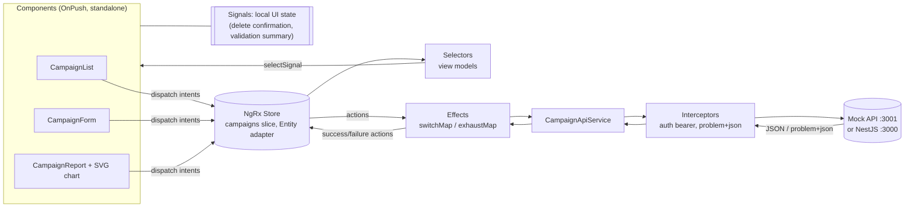

# 03 - AdFlow Angular + NgRx Dashboard

## What this is

A campaign management dashboard for **AdFlow**, a fictional ad platform (all data is synthetic). It consumes the shared contract
[`shared/contracts/campaign-api.openapi.yaml`](../../shared/contracts/campaign-api.openapi.yaml), so it runs against either a tiny
built-in mock API or the NestJS API from this monorepo.

Features: campaigns list (server-side pagination and status filter), create/edit form (reactive forms with validation),
campaign report with an accessible SVG chart, guarded lazy-loaded routes, bearer-token and problem+json HTTP interceptors,
and a prerendered (SSG) landing page.

Stack: Angular 20 (standalone, strict TypeScript, OnPush everywhere), NgRx Store/Effects/Entity, Signals, Jest, Playwright.

## Experience this project reflects

This is a deliberately compact version of patterns I have applied over 23 years of software delivery, of which many have been
spent in Angular, from the early 2.x/4.x releases (NgModules, RxJS-heavy code, template-driven everything) through the modern
standalone/Signals era (v17 to v19+):

- **Angular evolution:** migrating NgModule code bases to standalone components, the new control flow and `inject()`-based
  functional guards/interceptors, and deciding when to adopt Signals versus keeping RxJS.
- **NgRx state management:** feature-sliced stores registered lazily with their routes, entity adapters, memoised selectors as
  the read API, effects as the only place with side effects, and keeping the store limited to genuinely shared server state.
- **SSR/SSG strategy:** choosing per route between prerender (public, cacheable pages), server rendering (SEO + personalised
  content) and client-only rendering (authenticated dashboards), plus hydration and browser-only API guards.
- **OpenAPI contracts from Spring Boot and NestJS back ends:** treating the contract as the integration boundary, generating
  types from it so drift becomes a compile error, and mapping RFC 7807 problem responses consistently in one interceptor.
- **Performance:** OnPush change detection, lazy-loaded route chunks (the form, list and report load on demand), `track`
  in loops, cancelling stale requests with `switchMap`, and budgets enforced in the build.
- **Accessibility:** semantic HTML, programmatic labels, error summaries that receive focus, skip link, focus moved to the
  page heading on navigation, charts with text alternatives, and visible focus styles.

## Architecture



Folder layout:

| Path | Role |
| --- | --- |
| `src/app/core` | API client, models (types generated from the OpenAPI file), auth, guard, interceptors |
| `src/app/store` | Actions, reducer + entity adapter, selectors, effects (with specs) |
| `src/app/features` | Lazy routes and components (`campaigns`, `pages`) |
| `src/environments` | `environment.ts` (mock, default) and `environment.nestjs.ts` |
| `mock-api/server.mjs` | Dependency-free Node mock of the contract subset |
| `e2e/` | Playwright smoke test |

**API types:** `src/app/core/api.generated.ts` is generated with `openapi-typescript` (`npm run gen:types`);
`models.ts` only aliases those types, so a contract change surfaces as a compile error. The CI example checks it is in sync.

**Rendering:** the landing page and `/login` are prerendered at build time (`outputMode: "static"`, `app.routes.server.ts`);
everything under `/campaigns` is client-rendered because it is authenticated. A static host needs an SPA fallback to
`index.csr.html` for those paths.

## Why NgRx + Signals together (trade-offs)

- **NgRx for server state:** campaigns are shared across routes (list, edit, report), need cancellation, error handling and
  cache updates after mutations. Actions/effects make those flows explicit, testable and observable in DevTools.
- **Signals for local state:** a delete confirmation or a validation summary belongs to one component; putting it in the
  store adds boilerplate and global coupling for no benefit.
- **Bridge:** `store.selectSignal(...)` lets templates consume store data as signals, so components stay OnPush and
  RxJS stays inside effects instead of leaking into templates.
- **Costs:** more files and concepts than a signal-only service (`signalStore`/plain services would be enough for a tiny
  app), and two mental models for newcomers. The split rule used here: *if it comes from the server or is shared across
  routes, it goes to NgRx; if it dies with the component, it is a signal.*

## How to run

Requires Node 20+ (developed on Node 26).

```bash
npm install
npm start                # mock API on :3001 + dashboard on http://localhost:4200
```

Click "Open campaigns", then "Continue as demo advertiser" (synthetic token, accepted by the mock API).

Against the real NestJS API (`../02-nestjs-secure-api`, expected on `http://localhost:3000`; the token must be one that API
accepts, the demo token is only valid for the mock):

```bash
npm run start:nestjs     # uses src/environments/environment.nestjs.ts
npm run build:nestjs
```

Other: `npm run mock`, `npm run build`.

## How to test

```bash
npm test                 # Jest (jsdom), no browser needed: reducer, selectors, effects, interceptors, list component
npm run e2e              # Playwright smoke: sign in -> list -> create -> see it -> open report (mock API)
```

Playwright's browser download is optional and not part of `npm install`:

```bash
npm run e2e:install                 # downloads Chromium
PW_CHANNEL=chrome npm run e2e       # or reuse a locally installed Google Chrome
```

The e2e command starts the mock API and `ng serve` automatically (or reuses them if already running).
`.github/workflows/angular-ngrx-dashboard.yml` at the repo root shows a GitHub Actions workflow (type sync check, unit tests, build, e2e).

## Next steps

- Real authentication (OIDC/JWT login, refresh, role-aware UI for ADVERTISER vs ADMIN).
- Time-series report endpoint and richer charts; i18n.
- Server-side rendering for authenticated routes with transfer state, once tokens move to cookies.
- Component tests for the form and report; axe-core checks in Playwright.
- Optimistic updates and entity cache across pages.
