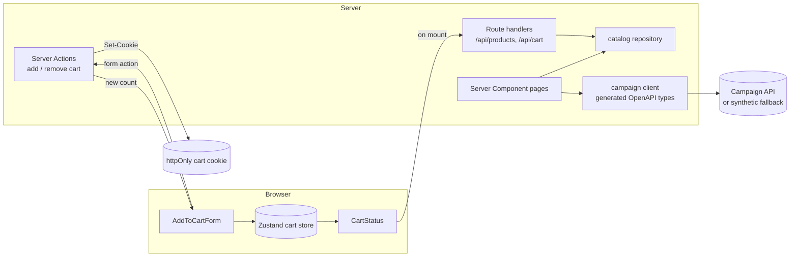

# 04 - AdFlow Shop: Next.js Storefront

## What this is

A small storefront for **AdFlow Shop**, a fictional shop that shows sponsored products (all data is synthetic). It exists to
show, route by route, *which rendering strategy fits which page* and why. Products come from a typed in-repo catalog behind a
data-access layer (`src/lib/catalog/repository.ts`). The `/advertiser` page consumes the shared contract
[`shared/contracts/campaign-api.openapi.yaml`](../../shared/contracts/campaign-api.openapi.yaml) (`GET /v1/campaigns`) with types
generated by `openapi-typescript`; without `CAMPAIGN_API_URL` it falls back to synthetic campaigns.

Stack: Next.js 16 (App Router), React 19, strict TypeScript, Zustand, Vitest + React Testing Library, Playwright, ESLint.

## Experience this project reflects

A compact version of patterns from 23 years of software delivery, including many years of React:

- **React evolution:** from early class components and mixins-era patterns, through Redux, to hooks and, now, Server Components
  and Server Actions; knowing what each generation solved and what it cost.
- **Next.js rendering strategies:** choosing per route between SSG, ISR, SSR and client-only rendering based on cacheability,
  personalisation and SEO, and keeping dynamic APIs (cookies, search params) out of routes that should stay static.
- **Mobile background:** React Native work shaped the habits used here: small payloads, predictable state, and caring about
  perceived performance on slow devices.
- **Working beside Angular teams:** sharing one OpenAPI contract between a React storefront and an Angular dashboard
  (see `../03-angular-ngrx-dashboard`), generating types so drift is a compile error.
- **Core Web Vitals and accessibility:** `next/image` with dimensions and `priority` for the LCP image, streaming with
  `Suspense`, no layout shift from skeletons, skip link, labelled landmarks, live regions and visible focus.

## Rendering strategy

| Route | Strategy | Why |
| --- | --- | --- |
| `/` | SSG | Same for everyone, cacheable on a CDN, best TTFB/LCP. |
| `/category/[slug]` | SSG (`generateStaticParams`, `dynamicParams = false`) | Small, known set of slugs; unknown slugs 404. |
| `/product/[slug]` | ISR (`revalidate = 60`) | Many pages, prices/stock change occasionally: static speed with bounded staleness. |
| `/search?q=` | SSR (`force-dynamic`) + Suspense streaming | Depends on the query per request; shell streams first. |
| `/cart` | SSR (reads cookie) | Per-user data. Mutations are Server Actions. |
| `/advertiser` | SSR + Suspense | Server-to-server call to the campaign API; token stays on the server. |
| `/api/products`, `/api/cart` | Route handlers | Small JSON API; `/api/cart` is `no-store`. |
| `/sitemap.xml`, `/robots.txt` | Metadata routes | Generated from the catalog; private routes are disallowed. |

Client components are limited to `AddToCartForm` (`useActionState`) and `CartStatus` (reads the Zustand store); everything else
is a Server Component.

## Architecture



| Path | Role |
| --- | --- |
| `src/app` | Routes, `loading.tsx`, metadata, sitemap/robots, route handlers |
| `src/lib/catalog` | Types, synthetic data, repository (the only import path pages use) |
| `src/lib/cart` | Pure cart helpers (cookie parse/serialise, tested) and Server Actions |
| `src/lib/campaigns` | Contract client + generated `api.generated.ts` (`npm run gen:types`) |
| `src/store` | Zustand store (UI mirror of the cart count, screen-reader announcements) |
| `e2e` | Playwright smoke tests |

## Trade-offs

- **Zustand over Redux Toolkit:** the only client state is the cart count mirror and an aria-live message. The cookie is the
  source of truth and server data is not duplicated in a client cache, so RTK's slices/middleware/RTK Query would be ceremony.
  Zustand needs no Provider (friendly to the App Router), and the store is trivially testable. For a large client-heavy
  app with complex flows and DevTools time-travel needs, RTK would be the better pick.
- **Cart in a cookie:** keeps the demo stateless and the root layout static. The header count is hydrated from `/api/cart`
  after load, so it briefly shows 0. A real shop would persist carts server-side keyed by session.
- **Cookie is untrusted input:** parsed strictly, ids validated against the catalog, quantities clamped.
- **ISR timestamp:** the product page prints its generation time to make revalidation observable; remove it in a real shop.
- **Search not cached:** simple and always fresh; a real shop would cache popular queries or use a search service.
- **Placeholder SVG images:** `next/image` still enforces sizes/lazy loading, but SVGs are not resized or converted.

## How to run

Requires Node 20+ (developed on Node 26).

```bash
npm install
npm run dev                         # http://localhost:3000
npm run build && npm start          # production behaviour (SSG/ISR)
```

Optional env vars: `SITE_URL` (sitemap/canonical base), `CAMPAIGN_API_URL` and `CAMPAIGN_API_TOKEN` (e.g. the NestJS API
from `../02-nestjs-secure-api`; the token is server-only). `make verify` runs lint, typecheck, tests and build.

## How to test

```bash
npm run lint
npm run typecheck
npm run test:ci          # Vitest + React Testing Library: repository, cart helpers, store, campaign client, components
npm run e2e              # Playwright smoke against a production build: browse -> add to cart -> cart; search; sitemap
```

Playwright's browser download is optional and may be blocked. Either download Chromium or reuse installed Google Chrome:

```bash
npm run e2e:install                 # downloads Chromium
PW_CHANNEL=chrome npm run e2e       # uses system Google Chrome
```

`.github/workflows/nextjs-storefront.yml` at the repo root is a GitHub Actions workflow (contract type sync, lint, typecheck, tests, build, e2e).

## Not verified

- Behaviour on a real CDN/hosting platform (ISR revalidation in a deployed environment, cache headers).
- Lighthouse / real-device Core Web Vitals numbers; no automated axe-core checks (accessibility was reviewed by hand).
- Running against the live NestJS API (only the fetch client is unit-tested with a mocked `fetch`).
- Browsers other than system Chrome; the CI workflow file has not been executed.
