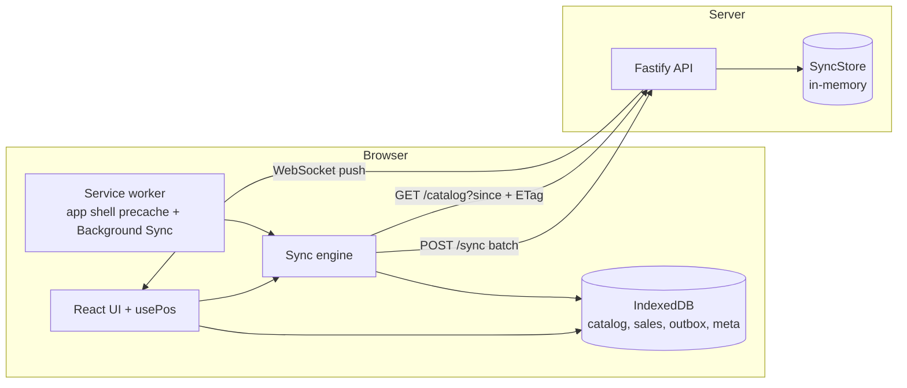

# 05 - AdFlow Retail: Offline-first POS PWA + sync server

## What this is

An offline-first point of sale for **AdFlow Retail**, a fictional store (synthetic catalog, simulated payments, no real
data). The till is a React PWA whose local source of truth is IndexedDB; sales are written together with an **outbox
command** (idempotency key) and synced in the background to a small Fastify server. The point is the hard part of retail
software: the network will fail, the sale must still complete, and it must reach the back office exactly once.

Stack: React 19, TypeScript (strict), Vite, `vite-plugin-pwa` (Workbox, injectManifest), `idb`, Fastify + WebSocket,
Vitest + `fake-indexeddb`, Playwright, ESLint.

## Experience this project reflects

A compact version of patterns from 23 years of building point-of-sale and retail systems in Java and TypeScript:

- **Never lose a sale:** the till is the system of record at the moment of payment; everything else converges to it.
- **Intermittent connectivity as the normal case:** outbox, ordered delivery, backoff with jitter, manual retry.
- **Idempotent integrations:** per-command keys and per-sale identity so retries, lost responses and replays are safe.
- **Explicit conflict policy:** server-authoritative prices, flagging instead of silent rewriting, last-writer-wins only
  where losing data is harmless.
- **Cashier ergonomics:** keyboard-first scanning flow, large touch targets, visible connection state, screen-reader
  announcements.

## Architecture



Diagram of the full offline sale, reconnect, sync and conflict flow: [`docs/sequence-offline-sale.md`](docs/sequence-offline-sale.md).
Decision record and conflict table: [`docs/adr-001-offline-first.md`](docs/adr-001-offline-first.md).

| Path | Role |
| --- | --- |
| `src/shared/protocol.ts` | Wire contract used by client and server |
| `src/db` | IndexedDB schema and repository (atomic sale + outbox write) |
| `src/sync` | Engine (ordering, batching, backoff, settle results), catalog pull/apply, HTTP transport |
| `src/domain/cart.ts` | Pure cart, quick-entry parsing, barcode lookup |
| `src/app` | UI and `usePos` hook (optimistic flow, connectivity, WebSocket) |
| `src/sw.ts` | Workbox precache, navigation fallback, Background Sync handler |
| `server` | Fastify app, in-memory store, validation, synthetic seed |
| `tests`, `e2e` | Vitest (engine, catalog, cart, API) and Playwright |

Conflict policy in one line: sales are never dropped; prices are server-authoritative but a sale is kept at the price the
customer was quoted and flagged `price_changed`; notes are last-writer-wins; invalid commands are parked, not deleted.

## Trade-offs

- **In-memory server store:** keeps the repo dependency-light and the tests fast; data is lost on restart. `SyncStore`
  is the only class to replace with SQLite/Postgres.
- **Client clock for LWW notes:** simple, but clock skew can reorder edits. Acceptable for non-critical text; not used
  for anything financial.
- **No auth / device registration:** `/admin/prices` and `/sales` are open demo endpoints. A real system needs device
  enrolment, tokens and encrypted local storage.
- **Charged price wins over list price:** protects the receipt, but means revenue can differ from list; hence the flag.
- **Head-of-line ordering:** a transiently failing command delays later ones. Correctness over throughput.
- **First launch requires a connection** to download the catalog and install the service worker.
- **Cart is in memory:** an unfinished sale is lost on reload; completed sales are durable.

## How to run

Requires Node 20+ (developed on Node 26).

```bash
npm install
npm run dev:server        # sync server on :8787
npm run dev               # web app on :5173 (proxies /api to the server; service worker is production-only)
npm run build && npx vite preview   # production build on :4173 with the service worker
```

Try it: load the preview build, switch DevTools to Offline, sell something, go back online, watch the badge change.
Change a price with `curl -X POST localhost:8787/admin/prices -H 'content-type: application/json' -d '{"sku":"AF-1002","priceCents":175}'`.
Quick entry accepts a SKU, a barcode or `3*AF-1001`; F2 focuses the field.

## How to test

```bash
npm run lint && npm run typecheck
npm run test:ci          # outbox ordering, backoff, lost-response idempotency, partial failure, conflicts, API, WebSocket
PW_CHANNEL=chrome npm run e2e   # offline sale -> reconnect -> exactly once on the server; price-drift flagging
```

`PW_CHANNEL=chrome` uses installed Google Chrome; otherwise run `npm run e2e:install` first. `.github/workflows/pos-offline-pwa.yml` at the repo root is a
GitHub Actions workflow to move into `.github/workflows/`.

## Not verified

- Real Background Sync with the tab closed (the handler is implemented, but e2e relies on the `online` event path).
- Browsers other than system Chrome; iOS Safari has no Background Sync and stricter IndexedDB eviction.
- Real devices, barcode scanner hardware, touch ergonomics, and automated axe-core accessibility checks.
- Multi-device conflicts and load; SQLite/Postgres persistence; the CI workflow has not been executed.
