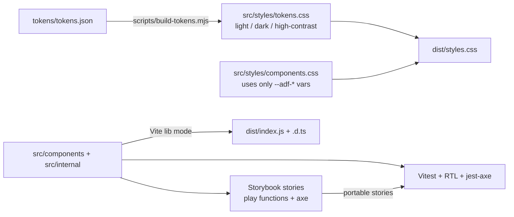

# 07 - AdFlow Design System

## What this is

`@adflow/design-system` is a small, accessible React component library for **AdFlow**, a fictional advertising platform (all
content is synthetic). It is built the way well-regarded open-source systems are: headless behaviour with composition
patterns, styling driven only by design tokens, documentation in Storybook, and publishing hygiene (exports map, size budget,
changesets).

Stack: React 19, strict TypeScript, Vite library mode (ESM + generated `.d.ts`), CSS custom properties generated from JSON
tokens, Storybook 10 (a11y addon), Vitest + React Testing Library + jest-axe, ESLint with `jsx-a11y`, Changesets, size-limit.

Components: `Button`, `TextField`, `Select` (select-only combobox), `Dialog`, `Tooltip`, `Tabs`, `Table` (sortable headers),
`Toast`, `Badge`, `Skeleton`.

## Experience this project reflects

Patterns distilled from 23 years of delivering front ends, including several years of building shared UI libraries:

- **Design systems as products:** versioned packages, an explicit public API, a size budget, a changelog and a release flow
  that consumers can trust, rather than a folder of shared components.
- **Accessibility as a build constraint:** WAI-ARIA Authoring Practices keyboard models, axe assertions on every component,
  and token-level contrast checks, so regressions fail CI instead of being found by users.
- **Composition over configuration:** compound components, polymorphism and controlled/uncontrolled state, the approach that
  replaced monolithic prop-heavy components across several framework generations (Angular and React alike).
- **Theming without runtime cost:** tokens as the single source of truth, CSS custom properties for switching themes, and
  respect for user preferences (colour scheme, contrast, reduced motion).

## Architecture



| Path | Role |
| --- | --- |
| `tokens/tokens.json` | Source of truth: base tokens plus the semantic colour set per theme |
| `scripts/` | `build-tokens.mjs` (JSON to CSS variables), `build-css.mjs` (bundles `dist/styles.css`) |
| `src/components` | One file per component, with `*.test.tsx` and `*.stories.tsx` beside it |
| `src/internal` | `Slot` (asChild), `Portal`, `useControllableState`, ref/handler composition (not all exported) |
| `src/stories.test.tsx` | Runs every story's `play` function and axe in jsdom (Storybook portable stories) |
| `playground/` | Plain Vite demo page (`npm run dev`), independent of Storybook |
| `.changeset/`, `.size-limit.json` | Release notes and bundle budget |

### Composition patterns

- **Compound components:** `Dialog` (`.Trigger/.Content/.Title/.Description/.Close`), `Tabs` (`.List/.Trigger/.Content`), `Table`
  (`.Header/.Row/.Head/.Cell`). Parts share state through context and fail with a clear error outside the root.
- **`asChild` (Slot):** `Button`, `Dialog.Trigger` and `Tooltip` render the consumer's element (e.g. a router link) with merged
  props, handlers, classes and refs. `Badge` shows the `as` polymorphic alternative with typed element props.
- **Controlled and uncontrolled:** `useControllableState` powers `value/defaultValue/onValueChange` (and `open/defaultOpen`).
- **`forwardRef` everywhere** a DOM node is exposed.

### Keyboard and ARIA behaviour

| Component | Behaviour |
| --- | --- |
| Button | Native button; `loading` uses `aria-disabled` + `aria-busy` so focus is not lost |
| TextField | Label, description and error wired via `for`, `aria-describedby`, `aria-invalid` |
| Select | APG select-only combobox: Arrow/Home/End/PageUp/PageDown, Enter/Space, Escape, typeahead, `aria-activedescendant` |
| Dialog | `role=dialog` + `aria-modal`, labelled/described, Tab focus trap, Escape, focus restore, body scroll lock |
| Tooltip | `role=tooltip` + `aria-describedby`; shows on focus, dismiss with Escape, hoverable (WCAG 1.4.13) |
| Tabs | Roving tabindex, arrows/Home/End, automatic or manual activation, horizontal or vertical |
| Table | `aria-sort` on `<th>`, real `<button>` for sorting, `useTableSort` helper |
| Toast | Labelled region; `role=status` (polite) or `role=alert` (danger); pauses on hover/focus; dismiss button |
| Badge / Skeleton | Meaning is in text, not colour; skeleton is `aria-hidden` inside an `aria-busy` container |

### Theming

`@adflow/design-system/styles.css` defines `--adf-*` variables. The default follows the OS (`prefers-color-scheme`,
`prefers-contrast: more`); setting `data-theme="light|dark|high-contrast"` on any ancestor overrides it. Under
`prefers-reduced-motion` the duration tokens become `0ms` and animations are disabled. Colour pairs are contrast-tested
(4.5:1 text, 7:1 in high contrast, 3:1 UI) in `src/tokens.test.ts`.

```tsx
import { Button, ToastProvider } from '@adflow/design-system';
import '@adflow/design-system/styles.css';
```

## Trade-offs

- **Hand-rolled primitives instead of Radix/Ariakit:** shows the mechanics (focus trap, roving tabindex, combobox) and keeps
  the bundle tiny (about 6 kB gzip JS). In production I would usually build on a battle-tested headless library; these
  implementations do not cover every edge case (nested dialogs, `inert` siblings, RTL arrow keys, virtualised lists, popper
  collision detection).
- **Plain CSS with tokens instead of CSS-in-JS or Tailwind:** zero runtime, easy theming and SSR; no per-component CSS
  splitting, so consumers import one stylesheet (about 3.5 kB gzip).
- **Select is not a filterable combobox:** an editable combobox with async options is a separate, larger component.
- **Tooltip and Select popups are not collision-aware:** fixed placement above/below; a real system would use floating-ui.
- **Single ESM entry:** `sideEffects: false` plus named exports lets bundlers tree-shake; per-component entry points were not
  needed at this size.
- **Toasts render in a portal region:** the provider owns the queue; no stacking limit or swipe-to-dismiss.

## How to run

Requires Node 20+ (developed on Node 26).

```bash
npm install
npm run storybook           # docs, controls, a11y panel and interaction tests on :6006
npm run dev                 # lightweight playground page (no Storybook needed)
npm run build               # tokens -> dist/index.js, dist/*.d.ts, dist/styles.css, dist/tokens.json
```

Storybook sends anonymous telemetry unless `STORYBOOK_DISABLE_TELEMETRY=1` is set.

## How to test

```bash
npm run lint             # ESLint incl. jsx-a11y (strict)
npm run typecheck
npm run test:ci          # 123 tests: per-component keyboard + jest-axe, token contrast, story play functions
npm run build && npm run size
npm run build-storybook
make verify              # lint, typecheck, tests, build, size
```

Release flow: `npm run changeset` (describe the change), `npm run version` (bumps version and `CHANGELOG.md`),
`npm run release` (build and publish). `.github/workflows/react-design-system.yml` at the repo root is a GitHub Actions workflow to move to `.github/workflows/`.

Visual regression is intentionally not set up. The planned approach is Storybook stories captured by Playwright (use
`PW_CHANNEL=chrome` when the browser download is blocked) or a hosted service, with per-theme baselines.

## Not verified

- Real browsers and assistive technology: tests run in jsdom, so layout, focus rings, colour rendering, and screen reader
  announcements (VoiceOver, NVDA, JAWS) were not checked. jsdom axe cannot evaluate colour contrast; contrast is checked on
  the token values only.
- Storybook UI was built but not opened, and its `play` functions run in jsdom via portable stories rather than a browser
  test runner.
- Visual regression, RTL layouts, SSR/hydration in a real framework, and publishing to a registry.
- The CI workflow file has not been executed.
