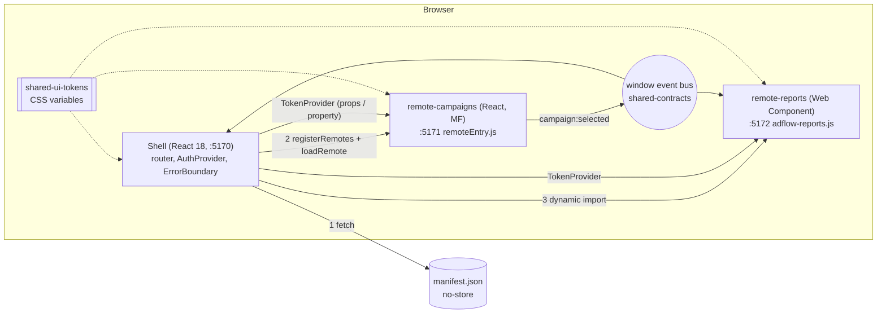

# 08 - AdFlow Micro-Frontends (Module Federation + Web Component)

## What this is

A micro-frontend reference for **AdFlow**, a fictional ad platform (synthetic data only). An npm-workspaces monorepo with:

| Workspace | Role |
| --- | --- |
| `apps/shell` | Host: routing, auth context, layout, error boundaries, **runtime remote loading from `manifest.json`** |
| `apps/remote-campaigns` | React remote exposed with Module Federation (`./Campaigns`), runnable standalone |
| `apps/remote-reports` | Framework-agnostic **Web Component** (`<adflow-reports>`, Shadow DOM) shipped as one ES module |
| `packages/shared-contracts` | Typed event bus, `TokenProvider` interface, manifest types |
| `packages/shared-ui-tokens` | CSS custom properties (design tokens) |

Demonstrated: shared singleton React, version-skew detection, lazy loading, failure isolation (fallback + retry + timeout),
decoupled communication (events), independent dev/build per app, and a deployment manifest.

## Experience this project reflects

Patterns from 23 years of front-end delivery, in generic terms:

- **Frontend architecture at team scale:** deciding where a seam belongs, and (as important) when not to cut one. See the ADRs.
- **Contracts as the integration surface:** events, auth and the manifest are typed, additive-only APIs between teams.
- **Release engineering:** deploy assets first, flip the manifest last, roll back by reverting one manifest entry.
- **Resilience:** timeouts, error boundaries, and a UI that degrades per region instead of failing globally.
- **Dependency governance:** singleton frameworks, explicit version ranges, and a policy for skew.
- **Angular and React:** Angular Native Federation / Angular Elements vs. Module Federation for React, and the trade-offs of each.

## Architecture



Load sequence: the shell fetches the manifest, checks each remote's `requires` against its own React version, then lazily
loads the remote on first navigation (8 s timeout). Any failure (network, timeout, skew, missing contract) is thrown inside
`React.lazy`, caught by the per-remote `ErrorBoundary`, and rendered as a fallback with Retry. The rest of the shell and the
other remote are untouched.

## Trade-offs

- **Module Federation vs. Web Component remote:** MF shares React (smaller, one instance) but couples remotes to the host's React range. The Web
  Component shares nothing (no skew risk, any framework) but bundles its own runtime and gives up shared libraries.
- **Window events** are loosely coupled and framework-neutral, but untyped at runtime and global. Typing lives in `shared-contracts`;
  the last-value cache is attached to `window` so separately bundled copies agree.
- **Runtime manifest** enables independent deploys but adds a request on the critical path and a new failure mode (the
  shell shows an error if the manifest is unreachable). A real setup would add caching/CDN and signing.
- **Own mini semver check** keeps the shell dependency-free; it covers `^ ~ >= exact *` only.
- **Angular Native Federation** was not used: see [ADR 0002](docs/adr-0002-federation-tooling.md).
- **Should you do this at all?** Often no: [ADR 0001](docs/adr-0001-when-not-to-use-micro-frontends.md).

## How to run

Node 20+ (developed on Node 26).

```bash
make install
make serve            # builds, then serves shell :5170, campaigns :5171, reports :5172 as 3 static origins
# open http://localhost:5170, sign in, open Campaigns, select a campaign, open Reports
```

Independent development (each in its own terminal): `make dev-campaigns` (runs standalone with a fake session),
`make dev-reports`, `make dev-shell`. Note the dev shell needs the remotes running on their ports (the manifest points there).

Independent deploy: rebuild one remote, publish its `dist/`, and change only its entry in `apps/shell/public/manifest.json`.

## How to test

```bash
make test                         # Vitest: event bus, token provider, manifest parsing/fetch/skew, semver, ErrorBoundary, web component
make typecheck
PW_CHANNEL=chrome make e2e        # builds, serves, Playwright smoke (use `make e2e-install` for bundled Chromium)
```

The e2e covers: shell loads, sign-in, both remotes open, event-driven selection flows from Campaigns to Reports, a downed
Web Component remote and a downed MF remote show fallbacks without affecting the other, and a skewed manifest yields a
`skew` fallback. `.github/workflows/micro-frontends.yml` at the repo root is a GitHub Actions workflow to move to the repo's workflows folder.

## Not verified

- Module Federation in **dev** mode (`vite` dev servers, HMR) across the three apps: only production builds were exercised end to end.
- Angular Native Federation / Angular Elements integration (not built).
- Browsers other than Google Chrome; CI workflow was not executed.
- Real auth, CDN caching headers, manifest signing, and SSR are out of scope.
