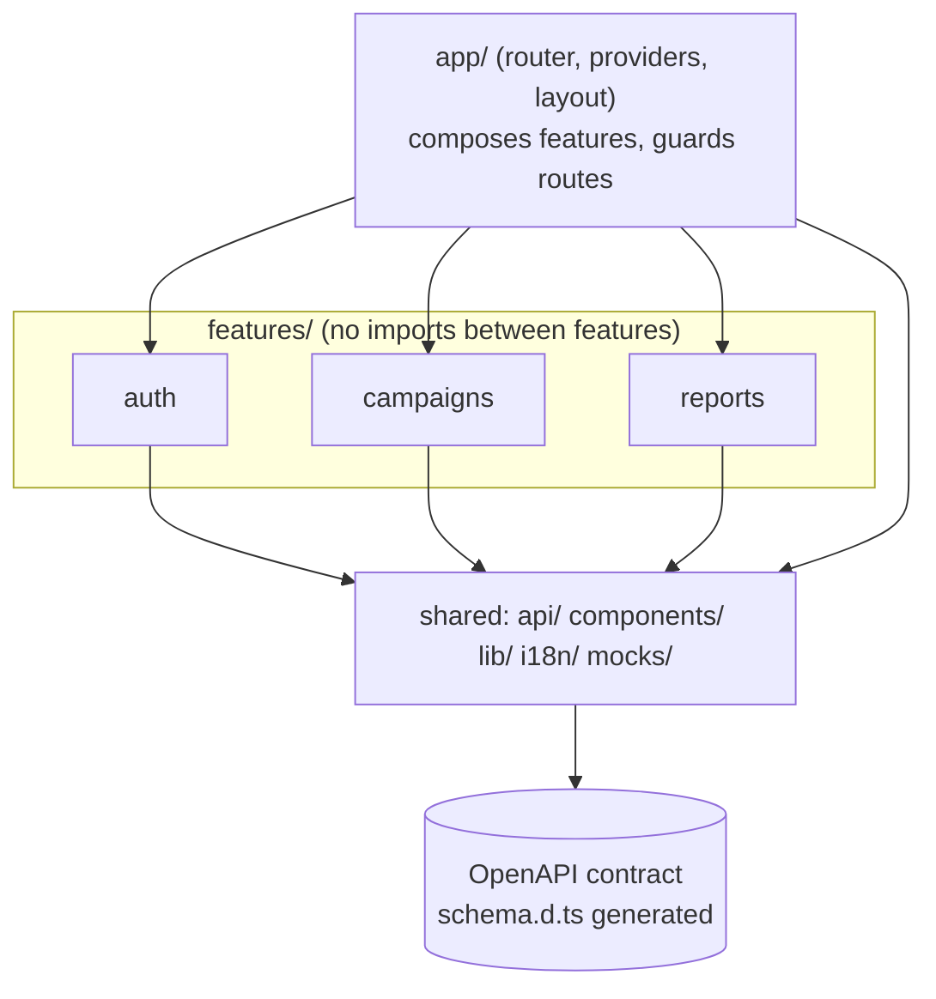

# 09 - AdFlow Console: React Feature Architecture

## What this is

A small React single-page app for **AdFlow**, a fictional ad platform (all data is synthetic), built to show how to keep a React
codebase scalable: feature folders with **enforced** boundaries, server state in TanStack Query, a typed API client generated from
the shared contract [`shared/contracts/campaign-api.openapi.yaml`](../../shared/contracts/campaign-api.openapi.yaml), and mocks
(MSW) that serve dev, unit tests and e2e from the same handlers.

Stack: React 19, Vite, strict TypeScript, React Router (lazy routes + loaders), TanStack Query, React Hook Form + zod,
`openapi-typescript` + `openapi-fetch`, MSW, Vitest + React Testing Library, Playwright, ESLint with `eslint-plugin-boundaries`.

## Experience this project reflects

Patterns from 23 years of software delivery, including many years of front-end work:

- **Structure scales by feature, not by file type:** after seeing "components/ services/ utils/" folders turn into a tangle on
  long-lived apps, the rule here is that a feature owns its API calls, schemas, components and tests, and the dependency
  direction is checked by the linter instead of by code review.
- **Contract-first front ends:** types come from the OpenAPI contract, so drift between API and UI is a compile error, and the
  same contract is consumed by other front ends (see `../03-angular-ngrx-dashboard`, `../04-nextjs-storefront`).
- **Server state is not client state:** a query cache with explicit invalidation, optimistic updates with rollback, and no
  hand-rolled loading flags.
- **Operational realism:** token refresh that survives parallel 401s, error boundaries with retry, skeletons that avoid layout
  shift, a gzip performance budget enforced in the build.
- **Accessibility and i18n as defaults:** labelled forms, live regions, skip link, visible focus, en/es catalogs checked for parity.

## Architecture



| Path | Role |
| --- | --- |
| `src/app` | Route table (one lazy chunk per feature route), auth-guard composition, layout, providers |
| `src/features/auth` | Login form, sign in/out, `requireAuth` route guard |
| `src/features/campaigns` | List (filter, pagination, Suspense), create form, optimistic status toggle |
| `src/features/reports` | Per-campaign report |
| `src/api` | `schema.d.ts` (generated), typed client with auth + single-flight refresh |
| `src/components`, `src/lib`, `src/i18n` | Shared UI (Field, Skeleton, ErrorBoundary, LiveRegion), session store, query client, en/es |
| `src/mocks` | MSW handlers typed from the contract, in-memory DB, browser + node setups |
| `e2e` | Playwright smoke tests |

**The boundary rule** (`eslint.config.js`, `boundaries/dependencies`): `app` may import features and shared; a feature may import
shared and *itself only*; shared may import shared only. Cross-feature needs (for example "guard this feature's loader with
auth") are composed in `app/router.tsx`. `src/architecture.test.ts` lints in-memory snippets and asserts the rule fires for
feature-to-feature (alias and relative), shared-to-feature and feature-to-app imports, and stays silent for legal ones.

Other details worth reading: `features/campaigns/api.ts` (optimistic mutation: cancel, snapshot, patch, rollback, invalidate),
`api/client.ts` (refresh), `mocks/handlers.ts` + `src/contract.test.ts` (every contract operation must have a mock).

## Trade-offs

- **Hand-written i18n (about 40 lines) instead of i18next:** two locales and `{var}` interpolation do not justify ~15 kB; typed keys
  and a parity test give most of the safety. Plurals/ICU would change that decision.
- **Access token in memory, refresh token in `sessionStorage`:** survives reload without persisting the access token, but
  `sessionStorage` is readable by XSS. Production should use an httpOnly, SameSite refresh cookie set by the identity service.
- **Auth endpoints are mocked and not in the contract:** `/auth/login` and `/auth/refresh` belong to a separate identity service.
- **`boundaries` enforces layers, not public APIs:** features still can reach into their own internals; pages are deliberately
  not re-exported from `index.ts` so they stay lazy.
- **Loaders prefetch without awaiting:** navigation is instant and Suspense shows skeletons; awaiting would block the transition
  but avoid the skeleton flash. Chosen for perceived performance.
- **Optimistic toggle only for status:** creates are not optimistic because ids and server defaults are server-owned.
- **React Router over TanStack Router:** fewer moving parts for loaders + lazy routes; TanStack Router's type-safe params would be
  the upgrade if route typing becomes the pain point.

## How to run / test

```bash
npm ci
npm run dev            # http://localhost:5173, backed by MSW (login: ada@adflow.test / adflow-demo)
npm run lint           # ESLint, including the architecture boundaries rule
npm run typecheck
npm test               # Vitest + RTL + MSW (includes architecture and contract tests)
npm run build          # tsc + vite build + gzip performance budget (scripts/check-budget.mjs)
npm run analyze        # dist/stats.html treemap (rollup-plugin-visualizer)
PW_CHANNEL=chrome npm run test:e2e   # or run `npx playwright install chromium` and omit PW_CHANNEL
npm run gen:types      # regenerate src/api/schema.d.ts; `npm run check:types` fails if stale
```

`make verify` runs everything; `.github/workflows/react-feature-architecture.yml` at the repo root is the workflow to move into `.github/workflows/`.

**Performance budget** (gzip, per file): entry 110 kB, shared chunk 45 kB, route chunk 25 kB. Current entry is about 95 kB.
The mock service worker is only imported when `VITE_MOCKS=true`, so MSW is not in the production bundle
(`public/mockServiceWorker.js` is copied to `dist` but unused; drop it in a real deployment pipeline).

## Not verified

- No real backend: everything runs against MSW; the contract is checked structurally (types, operation coverage), not by
  provider-side contract tests.
- Only Chrome (installed channel) was used for e2e; no Firefox/WebKit, no mobile viewports.
- Accessibility was built to guidelines and linted (`jsx-a11y`), but not audited with axe or a screen reader.
- Spanish copy has not been reviewed by a native speaker.
- Lighthouse / real-device performance was not measured; the budget is a bundle-size proxy.
