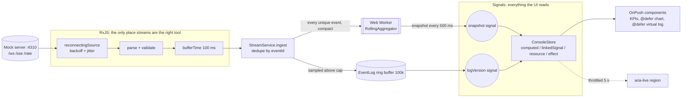

# 10 - AdFlow Realtime Ad-Events Console

## What this is

A real-time monitoring console for **AdFlow**, a fictional ad platform (all data is synthetic). It subscribes to a stream of
impression and click events whose shape follows [`shared/contracts/ad-events.asyncapi.yaml`](../../shared/contracts/ad-events.asyncapi.yaml),
shows rolling CTR per campaign and events per second, and keeps a searchable 100,000-row event log that stays smooth under
20,000 events per second.

Stack: Angular 20.3 (standalone, **zoneless**, **Signals-first**, OnPush), RxJS 7 for the socket stream only, a Web Worker, CDK virtual
scrolling, `@defer`, Jest (zoneless), Playwright. A dependency-light Node mock server (`ws` only) streams events over WebSocket and SSE.

How this differs from [`03-angular-ngrx-dashboard`](../03-angular-ngrx-dashboard): that one is request/response CRUD with NgRx.
This one is a push-based, high-throughput UI where the hard problems are backpressure, main-thread budget, reconnection and
accessibility of a firehose. There is deliberately no NgRx here.

## Experience this project reflects

23 years of delivery, Angular since its early versions (2.x/4.x, NgModules, zone.js everywhere) through the signals era:

- **Zoneless migration reasoning:** with `provideZonelessChangeDetection()` and no `zone.js` polyfill, rendering is scheduled only
  by signal writes and template events. Socket and worker callbacks just write signals; nothing patches timers or promises.
- **Choosing the reactive primitive per problem** (rule below), instead of "everything is an Observable" or "everything is a signal".
- **Throughput engineering:** batch, sample, move CPU work off-thread, bound every buffer, measure.
- **Resilience:** reconnect with exponential backoff and jitter, idempotent consumption of an at-least-once stream.
- **Accessibility under motion:** live regions that do not spam, keyboard-first controls, tabular data semantics.

## Architecture



| Path | Role |
| --- | --- |
| `src/app/core/reconnecting-source.ts`, `backoff.ts` | Reconnect state machine as an Observable; pure backoff function |
| `src/app/core/transport.ts` | WebSocket / EventSource openers behind a tiny `Opener` interface (faked in tests) |
| `src/app/core/stream.service.ts` | Pipeline, batching, dedupe, backpressure, pause semantics |
| `src/app/core/aggregator.ts` | Pure rolling aggregates (no I/O, no clock): CTR per campaign, events/s, history |
| `src/app/core/aggregate.worker.ts`, `worker-aggregator.ts`, `aggregator-port.ts` | Worker host, main-thread proxy, port + inline fallback |
| `src/app/core/event-log.ts` | Ring buffer (100k) and bounded recent-id set |
| `src/app/core/console.store.ts` | UI state: signals, `computed`, `linkedSignal`, `resource`, `effect` |
| `src/app/features` | Controls, KPI strip, CTR table (deferred), virtual event log (deferred) |
| `mock-server/server.mjs` | WS + SSE emitter, adjustable rate, 0.5% duplicates, `/admin/drop` to test reconnect |
| `scripts/` | Benchmarks |

## When Signals, when RxJS (the rule used here)

> **Signals hold state; RxJS describes events over time.**
> If the question is "what is the value now?" it is a signal. If it is "what happens when things arrive, in what window, with what
> retry and teardown?" it is a stream. Convert at the boundary, once, and keep templates signal-only.

| Concern | Tool | Why |
| --- | --- | --- |
| Socket messages -> parse -> `bufferTime` | RxJS | Time-windowing, teardown on unsubscribe, composition with the retry state machine |
| Reconnect with backoff | RxJS `Observable` wrapping the opener | Lifecycle (subscribe = connect, unsubscribe = close and cancel timers) |
| Connection status, paused, counters, snapshot | `signal` | Plain current values read by templates |
| Filtered rows, overall CTR, status text, chart scale | `computed` | Derived, memoised, no manual subscription |
| Campaign filter that must reset when its option disappears | `linkedSignal` | Writable derived state without an effect |
| Server config (campaign list, rate presets) | `resource` | Loading/error/value + abort on destroy, no `HttpClient` stream needed for a one-shot fetch |
| `document.title`, theme attribute, localStorage, connect/disconnect on transport change, 5 s announcements | `effect` | Only for leaving the signal graph. No effect ever writes app state derived from other state |

The only mutable non-signal is the 100k ring buffer (copying it per flush would defeat the point). It is hidden behind
`logVersion`, a signal bumped once per flush, which `computed` rows depend on. That is a conscious trade-off: one mutable
structure, one explicit change notification.

## Throughput and backpressure

1. **Batching:** `bufferTime(100)` turns up to thousands of messages into one `ingest`, so the UI sees at most 10 signal updates/s.
2. **Sampling:** if a flush has more than 2,500 unique events, the *log* receives an evenly spaced sample; the dropped count is
   shown ("Sampled out"). Aggregates are never sampled, they receive every unique event.
3. **Off-thread aggregation:** a Web Worker owns the rolling window. The main thread posts compact events and receives one snapshot
   every 500 ms regardless of input rate. Without `Worker` (tests) the same class runs inline.
4. **Bounded memory:** ring buffer (100k rows), per-second buckets pruned to 30 s, two-generation id set for de-duplication,
   server skips consumers whose socket buffer exceeds 8 MB.
5. **Idempotency:** the contract is at-least-once, so duplicates (the mock sends 0.5%) are dropped by `eventId` and counted.
6. **Pause:** freezes the *views* (log and KPIs), not the data. Data keeps flowing and resume catches up in one update.

## Reconnection

`backoffDelay` is "equal jitter": `step/2 + random * step/2` with `step = min(cap, base * 2^attempt)` (500 ms base, 15 s cap). The fixed
half prevents hot loops; the random half de-synchronises clients dropped at the same moment. The attempt counter resets on a
successful open, stale callbacks from abandoned attempts are ignored (generation counter), and `EventSource`'s built-in retry is
bypassed so both transports share one policy.

## Rendering, change detection, SSR

- **Zoneless:** supported and used (`provideZonelessChangeDetection`, no `zone.js`). In Angular 20.3 it is stable enough for apps, but
  third-party libraries that rely on zone patching need checking; CDK scrolling and forms work.
- **OnPush everywhere**, `track` expressions on every loop, `trackBy` on the virtual list.
- **`@defer (on idle)`** for the CTR panel and the event log; the log (and with it CDK scrolling, ~28 kB raw / ~8 kB gzip) is a
  separate chunk, with accessible placeholders.
- **SSR / deferred hydration: intentionally not used.** This is an authenticated, socket-driven console with no SEO need; server
  rendering a live stream would only add a hydration mismatch risk. (Compare the SSG choices in project 03.)
- **Dark mode:** CSS custom properties, follows `prefers-color-scheme` until the user toggles, persisted.

## Accessibility

- Controls are native `<button>`/`<select>` elements, in DOM order, with visible 3 px focus rings. **P** toggles pause globally
  (`aria-keyshortcuts`), ignored while a form field has focus. Pause is an `aria-pressed` button with a text label that changes.
- **Live regions are throttled by design:** one `role="status"` `aria-live="polite"` region receives a summary every 5 s
  ("N events per second. Overall click-through rate ..."), plus the connection status text when it changes. The event log itself is
  not live. Announcements stop while paused or disconnected.
- The virtual log is a focusable scroll region with `role="table"`, `aria-rowcount` for the full logical size and `aria-rowindex`
  per rendered row, so the 100,000 rows are communicated even though ~45 exist in the DOM. Skip link to the log.
- The CTR "chart" is a real table; the bars are `aria-hidden` decoration. `prefers-reduced-motion` is respected.
- Known limit: rows are newest-first, so while the stream is running the list shifts under the reader. Pausing is the answer
  (and it is keyboard-accessible); an "anchor to selected row" mode would be the next improvement.

## How to run

Requires Node 20+ (developed on Node 26).

```bash
npm install
npm start          # mock server on :4310 + console on http://localhost:4200
```

Port 4310 was chosen to avoid clashes with common local services. Another server: `http://localhost:4200/?server=http://host:port`.
Change the emission rate from the UI (select) or `curl -X POST localhost:4310/rate -d '{"eps":5000}' -H 'content-type: application/json'`
(the rate is global to the server, max 50,000). `curl -X POST localhost:4310/admin/drop` kills all connections to see the reconnect.

## How to test

```bash
npm test                          # Jest, zoneless TestBed, fake timers
PW_CHANNEL=chrome npm run e2e     # Playwright against the mock server + ng serve (starts both)
npm run e2e:install               # optional: download Playwright's Chromium instead of using PW_CHANNEL
```

Unit tests cover: backoff maths (bounds, cap), the reconnect state machine with fake timers (delay growth, reset on open,
stale callbacks, teardown cancels timers), the pure aggregator (CTR, windows, expiry, events/s), ring buffer and id set, the stream
service (batching, malformed input, dedupe, sampling, pause/resume, drop and recovery) and the store's `computed`/`linkedSignal`/
`effect`-driven behaviour (filters, options, status text, 5 s announcement throttle, transport switch).

E2E covers: streaming and the `@defer`red panels, keyboard pause/resume, type filter, forced disconnect and reconnect, SSE
transport, dark-mode persistence, and filling the log to 100,000 rows with fewer than 60 DOM rows.

## Performance (measured)

Measured on one macOS laptop (exact model not recorded), Node v26.7.0, Google Chrome via Playwright
(`PW_CHANNEL=chrome`), production build served by the mock server, mock at 20,000 events/s on the same machine, three runs
of `npm run bench:browser`:

| Metric | Result |
| --- | --- |
| Time from rate change to a full 100,000-row log | 5.3 s, 5.8 s, 5.8 s (the stream itself needs 5.0 s at 20k/s) |
| Frame pacing while scrolling the log at 20k ev/s for 5 s | 60 fps, p95 frame 16.8 ms, max frame 16.8 ms (all 3 runs) |
| Main-thread long tasks (>50 ms) | 0 in all runs |
| Rows rendered in the DOM with 100,000 logical rows | 45-46 |
| JS heap after fill | 48 MB, 64 MB, 73 MB |
| Production initial bundle | 186 kB raw / 55 kB gzip; event-log chunk 28 kB / 8 kB gzip; worker 1.5 kB |

`npm run bench` (pure aggregator in Node, 1,000,000 events in 2,000-event batches): about 10-11 ms per million events across three
runs (roughly 88-100 million events/s) and about 7-8 us per snapshot. This is a micro-benchmark of the algorithm, not of the browser.

Caveats: single machine, headless Chrome, rAF is capped at the display refresh so "60 fps" means "no dropped frames", not
"headroom"; No Chrome DevTools trace file is committed.

## Trade-offs and what I would change next

- JSON parsing still happens on the main thread; at much higher rates parsing and `bufferTime` should move into the worker
  (transferring `ArrayBuffer`s), leaving the main thread only the sampled log.
- The log is an in-memory ring; "export" or time-travel would need IndexedDB.
- The mock rate is global (one control for all clients); a real service would be per-subscription with server-side filters.
- Add axe-core checks and a screen-reader pass in the e2e suite; add a Chrome trace capture to `bench:browser`.
- `resource` is still marked experimental in Angular 20; it is used only for a non-critical one-shot config fetch.
