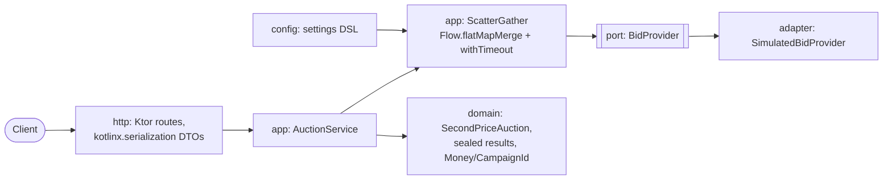

# AdFlow Scatter/Gather Auction Service (Kotlin, Ktor, coroutines)

## What this is

A small Kotlin 2.2 / Ktor 3 service for the (fictional) "AdFlow" ad platform. `POST /v1/auction` fans a request out to
several simulated bid providers with bounded parallelism and a per-call timeout, aggregates whatever came back in time,
and returns the winner under a **second-price** rule. Slow or failing providers degrade the result; they never fail it.

```http
POST /v1/auction   {"slotId":"home-top","floorCents":100}
200  {"status":"WON","winner":{"provider":"bravo","campaignId":"cmp-bravo","bidCents":500},
      "clearingPriceCents":400,"participants":3,"unavailable":[{"provider":"slow","reason":"TIMEOUT"}]}
```

`NO_WINNER` (nobody at or above the floor, or nobody answered) is a normal 200 result. Invalid input is a 400.

**Second-price rule** (`SecondPriceAuction`): bids below the floor are ignored; highest remaining bid wins; ties go to the
lowest provider id (deterministic); the winner pays `max(second-highest eligible bid, floor)`, so a lone bidder pays the
floor. The outcome is independent of the order providers answered in. All data is synthetic, providers are deterministic
simulations (no network, no randomness).

## Experience this project reflects

23 years on the JVM, mostly Java and Spring. What I wanted to show here is idiomatic Kotlin rather than Java with
different syntax: structured concurrency that cancels correctly, expected failures modelled as values (sealed types and
exhaustive `when`) instead of exceptions, value classes for domain primitives, immutability by default, and tests that
state invariants instead of examples only.

## Architecture



`domain` depends on nothing; `app` depends on `domain` and the `port`; adapters implement the port.

Kotlin features on show: `@JvmInline value class` (`Money`, `CampaignId`, `ProviderId`, `SlotId`), sealed interfaces
(`ProviderOutcome`, `AuctionResult`, `Behavior`, `Validated`) with exhaustive `when` and no `else`, extension properties
(`5.cents`), a `@DslMarker` configuration DSL (`auctionSettings { providers { simulated("a") { ... } } }`), data classes,
null as "provider declined / invalid money", `Duration`.

Concurrency details worth knowing:
- `flatMapMerge(concurrency = n)` gives bounded parallelism, and the timeout starts when a call starts, not while it queues.
- `withTimeout` throws `TimeoutCancellationException`, which is a `CancellationException`. Only that one is turned into a
  `TimedOut` value; any other `CancellationException` is rethrown so cancelling the caller really cancels the work.
- Worst-case latency is `ceil(providers / maxParallel) * perCallTimeout`. There is no separate overall deadline.

## Trade-offs

| Decision | Why | Trade-off |
|---|---|---|
| Flow `flatMapMerge` instead of `Semaphore` + `async` | Declarative, bounded, cancellation-safe | `flatMapMerge` is still `@ExperimentalCoroutinesApi`; results arrive unordered (the auction sorts anyway) |
| Failures as sealed values | Compiler forces handling; partial results are natural | More types than a `try/catch`; unexpected bugs still throw |
| Value classes for ids and money | Type safety, no allocation in most cases | Boxing when used as generics/nullable; `init` checks throw on programmer error |
| Money as `Long` cents, USD only | Exact arithmetic | No currency, no overflow guard beyond `Long` |
| Simulated providers only | Deterministic, no secrets or network | No real HTTP client adapter, retries or circuit breaking |
| Ktor over Spring Boot | Small, coroutine-native | Fewer batteries (metrics, security, config) than Boot |
| kotest + JUnit platform | Property testing and readable specs | Two test vocabularies with `kotlinx-coroutines-test` |

## Java vs Kotlin: when I choose which

Honest, from long use of both:
- **Kotlin** for new services and anything with rich domain modelling or async fan-out: sealed types and `when`
  remove a lot of defensive code, coroutines make cancellation and timeouts far easier to get right than hand-rolled
  `CompletableFuture` chains, and null-safety catches a real class of bugs at compile time.
- **Java** when the team and codebase are Java-first, when hiring/onboarding speed matters more than ergonomics, or for
  libraries consumed widely from other JVM languages. Java 21 (records, sealed types, pattern matching, virtual threads)
  closed much of the gap; with virtual threads, blocking code is often simple enough that coroutines are not needed.
- Costs of Kotlin I do not hide: slower compile times, a second ecosystem of idioms (coroutines, Flow) the team must learn,
  easy-to-misuse features (extension sprawl, DSLs, swallowing `CancellationException`), and framework plugins (`allopen`,
  Jackson modules) for Spring. Mixed codebases work fine; I would not rewrite working Java just to switch.

## How to run

```bash
mvn -B package
PORT=8080 mvn -B exec:java -Dexec.mainClass=com.adflow.auction.MainKt   # or run MainKt from the IDE
curl -s localhost:8080/v1/auction -H 'content-type: application/json' -d '{"slotId":"home-top","floorCents":100}'
```

The demo wiring (`demoSettings()`) has six simulated providers: two slow-ish bidders, a decliner, a hanging one (times
out) and a failing one.

## How to test

```bash
mvn -B verify          # compile, 22 tests, ktlint check
mvn -B ktlint:format   # auto-format
```

| Layer | Tests |
|---|---|
| Rule | `SecondPriceAuctionTest`: examples + 5 kotest property tests (winner is the max, price within [floor, bid], price equals second bid, order independence, truthfulness: raising the winning bid never changes what it pays, adding a low bid changes nothing) |
| Concurrency | `ScatterGatherTest` with `runTest` virtual time: timeout, bounded parallelism and total virtual time, failure isolation, declines, caller cancellation propagating to in-flight calls |
| HTTP | `AuctionApiTest` with Ktor `testApplication`: winner and second price, partial result with TIMEOUT/ERROR, `NO_WINNER`, 400 on bad input |

### Results of the last run (JDK 21, Maven 3.9)

`mvn verify`: 22 tests, 0 failures, ktlint clean, BUILD SUCCESS.

## Not verified

- Netty startup was smoke-tested once by hand with `mvn exec:java` and `curl` (prefix-resolved plugin, not pinned in the
  pom); it is not part of the automated suite.
- Real network behaviour: simulated providers use `delay`, so real socket timeouts, connection pools and back-pressure
  are not covered. No load test.
- The API contract is documented here only; there is no OpenAPI file and no shared-contract test.
- CI workflow was not run on GitHub.
