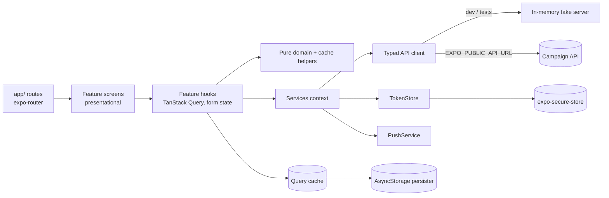

# 12 - AdFlow Mobile: React Native (Expo) App

## What this is

A mobile app for advertisers on **AdFlow**, a fictional ad platform (all data is synthetic, there are no real accounts and no
secrets). It covers a mock login, a paginated campaign list with pull-to-refresh, a campaign detail screen with a report chart
and an optimistic pause/resume, a push-notification permission flow, secure token storage and an offline cache. The API client
follows [`shared/contracts/campaign-api.openapi.yaml`](../../shared/contracts/campaign-api.openapi.yaml)
(`GET /v1/campaigns`, `GET/PATCH /v1/campaigns/{id}`, `GET /v1/campaigns/{id}/report`) and talks to an in-memory fake server by
default, so the app and the tests run with no backend.

Stack: Expo SDK 57 (managed), React Native 0.86, React 19, strict TypeScript, expo-router, TanStack Query (with persisted
cache), react-native-svg, expo-secure-store, Jest (jest-expo) + React Native Testing Library, ESLint.

## Experience this project reflects

A compact version of patterns from 23 years of software delivery, including years of mobile work:

- **Mobile background across generations:** hybrid and cross-platform toolkits (Xamarin/Titanium) and React Native; the habits
  carried over are small payloads, defensive handling of flaky networks, and treating the device as a hostile environment.
- **Native concerns behind interfaces:** secure storage and push permissions are interfaces (`TokenStore`, `PushService`) with
  production, stub and in-memory implementations, so platform APIs never leak into screens or tests.
- **Offline-first thinking:** server state is cached and persisted; a failed refresh keeps showing saved data with a clear banner.
- **Predictable UI updates:** optimistic changes with explicit rollback instead of spinners everywhere.
- **Accessibility and theming:** labelled controls, roles, hints, text alternatives for charts, minimum touch targets and a
  light/dark palette that follows the system.
- **Contract-first APIs:** one OpenAPI file shared with web clients and the API, with a test that fails if the mirrored types drift.

## Architecture



| Path | Role |
| --- | --- |
| `app` | Thin route files (expo-router): layouts, auth gate, one-line screen mounts |
| `src/features/auth` | Mock auth service, provider, login form hook, validation |
| `src/features/campaigns` | Query hooks, optimistic toggle, cache rewriting helpers, pure domain (formatting, funnel), screens, chart |
| `src/features/notifications` | Permission hook and prompt |
| `src/core` | `ServicesProvider` (composition root), `TokenStore`, `PushService`, query client and persister |
| `src/api` | Contract types, typed client with `ApiError` (problem+json), fake server |
| `src/navigation/routes.ts` | Typed route builders used by every navigation call |
| `src/theme` | Light/dark palettes and `useTheme` |

Rules followed: components render and call hooks; hooks hold state and orchestration; decisions (can this campaign be toggled,
how wide is a bar, what is valid input) are pure functions with their own tests.

Optimistic pause/resume: `onMutate` cancels in-flight queries, snapshots the detail and list caches, rewrites both; `onError`
restores the snapshots; `onSettled` invalidates so the server value wins.

## Trade-offs

- **TanStack Query over Redux:** nearly all state is server state. The persisted query cache gives offline reads for free;
  client state (auth, form) is small enough for context and local state.
- **AsyncStorage persister over MMKV:** works in Expo Go and on web with no native build. MMKV is faster and synchronous but
  needs a dev client; the persister is isolated in `src/core/queryClient.ts` so swapping it is local.
- **Cache is not encrypted:** campaign data in AsyncStorage is plain text; only the token is in the secure store. The cache is
  wiped on sign-out and on a 401. Sensitive data would need an encrypted store.
- **Hand-mirrored types plus a drift test** instead of generated types: no codegen dependency for four endpoints. Generating them
  with `openapi-typescript` (as project 04 does) is the better choice as the contract grows.
- **Own typed route builders** instead of expo-router's generated `typedRoutes`: those types are produced by the dev server and
  are absent on a clean CI checkout, which would make typecheck depend on running Metro.
- **Fake server instead of MSW:** it is the same code path in dev, tests and the web export, with deterministic data and
  failure injection (`failNextPatches`). MSW is better when you need per-test handler overrides at the network layer.
- **Report chart is a funnel** (impressions vs clicks, CTR and spend as text) because the contract only exposes aggregates, not a
  time series. A trend line would need a new endpoint rather than invented data.
- **Push is a stub:** the interface and UX states (undetermined, granted, denied is final) are real; token registration and
  delivery are not.
- **No network-status detection** (e.g. NetInfo): offline is inferred from a failed refetch.

## How to run

Requires Node 20+ (CI uses Node 22).

```bash
npm install
npm start                 # Expo dev server; open in Expo Go or a simulator
npm run web               # browser
```

Demo sign-in: any email, password `adflow-demo`. Set `EXPO_PUBLIC_API_URL` to use a real API (e.g. `../02-nestjs-secure-api`)
instead of the fake server; note the mock login still returns the fake token, so a real API needs a real auth service.

## How to test

```bash
npm run lint
npm run typecheck
npm run test:ci           # API client, contract drift, token store, push stub, domain, hooks (pagination, optimistic rollback), screens
npm run export:web        # build smoke test (expo export --platform web)
```

`.github/workflows/react-native-app.yml` at the repo root runs install, lint, typecheck, tests and the web export.

## Not verified

- The app has never been run on a physical device, an iOS simulator or an Android emulator; only Jest (jest-expo), lint,
  typecheck and a successful web export were run. Native behaviour of `expo-secure-store`, safe areas and pull-to-refresh
  gestures is therefore untested (secure store is only tested against a mock).
- The web export was built but not opened in a browser.
- Accessibility labels were reviewed by hand, not with VoiceOver or TalkBack.
- Running against the real NestJS API, and the CI workflow file itself, have not been executed.
